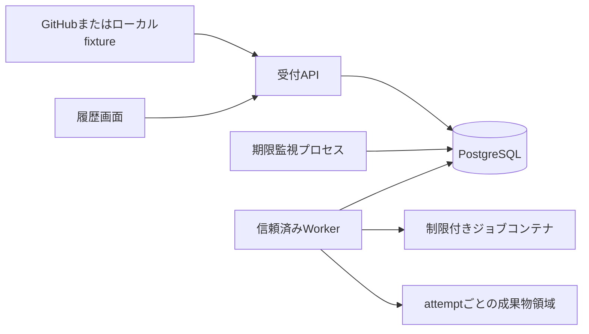

# 信頼性を検証するジョブ実行基盤 — CIを題材にする計画

- 作成・技術資料確認: 2026-10-14
- 状態: 未実装の開発計画。数値は検証条件・設計目標であり実績ではない。
- 位置づけ: [全体比較](next_project_plan.md)の独立候補。バックエンド・非同期処理を重点的に学ぶ場合に選ぶ。

## 1. 作る理由と既存成果との差

自分のリポジトリへの変更を受け、指定したコミットのチェックを実行し、失敗理由と再試行履歴を追える開発者向けツールを作る。利用者は、複数の小さなプロジェクトを検証したい開発者本人とする。

[開発管理ダッシュボード](../260406/dashboard/README.md)にはWeb/API/DB/Dockerの経験がある。[ブロックチェーンのNode](../260702/blockchain/node.py)は同一プロセス内の同期シミュレーションである。今回の新しい学習対象は、別プロセスのWorker、永続キュー、並行取得、実行権の期限、故障後の回復である。既存のPages公開経験を「CI未経験」とは扱わない。

元案の「CI/CD」は範囲を修正する。MVPで作るのはCI用ジョブ実行基盤であり、本番環境への継続的デプロイ（CD）は含まない。企業への説明材料は、処理系統の数より、障害を再現して設計判断を証明した記録とする。

## 2. 最初に完成させる範囲

| MVPで実装するもの | 発展課題にするもの |
|---|---|
| 管理下の公開サンプルリポジトリ1つ、固定された検証手順1つ | 任意リポジトリ・外部PR・任意YAMLの受付 |
| 手動投入と署名付きpush Webhook、対象ブランチ1つ | GitHub App、多組織、多利用者、詳細な権限管理 |
| Worker 1つから始め、同一ホスト上2プロセスで競合を検証 | 複数ホスト、自動増減、優先度付きDAG |
| 隔離実行、上限付きログ、結果・成果物、タイムアウト | キャッシュ共有、秘密情報のジョブへの注入 |
| 実行権期限・再試行・古い結果の拒否・キャンセル | 外部副作用の一度だけの実行保証、CD |
| 実行履歴と障害実験の画面 | GitHub Actions互換や公開Runnerサービス |

最初のfixtureは外部依存のないPythonプログラムとし、成功・終了コード失敗・長時間処理・大量ログの4種類を用意する。既存プロジェクトへの接続は基本動作後に行う。後続のMLOps案を完成させる前提にはしない。

## 3. 暫定構成と責任分担

Python/FastAPI、PostgreSQL、Docker Engine、最小のHTML/JavaScriptを候補とする。言語を増やす負荷を抑え、学習を状態管理に集中する。開始時に互換バージョンを選び固定する。

DBをキューと履歴の正本にし、RedisとDBの二重更新問題をMVPで増やさない。ジョブ取得は短いトランザクション内で行い、実行中に行ロックを保持しない。`FOR UPDATE SKIP LOCKED`を使う取得方式を学ぶ。この句は一般的な一貫した読み取りの代替ではなく、キューの競合回避に適用する。[PostgreSQL SELECT](https://www.postgresql.org/docs/current/sql-select.html)

自作するのは状態遷移、取得SQL、再試行判断、期限監視、成果物確定の条件である。HTTP・暗号・コンテナ・SQLドライバは既存実装を利用する。コンテナを起動する権限はWorkerだけに渡す。

## 4. データと守る性質

| データ | 主な項目・制約 |
|---|---|
| deliveries | 設定済みhook識別子、delivery ID、bodyハッシュ、受信時刻、処理結果。hookとdeliveryの組に一意制約 |
| runs | run ID、repository ID、ref、commit SHA、workflow版、状態、作成時刻、キャンセル要求時刻 |
| attempts | run ID、試行番号、Worker ID、実行権token、期限、開始終了時刻、exit code、理由 |
| artifacts | attempt ID、相対名、サイズ、SHA-256、保存先。名前はサーバー生成、容量に上限 |

1. 受付とrun作成を同じDBトランザクションで永続化してから受理応答を返す。DB停止中に受理済みとは答えない。
2. 同じイベントは同じrunを返す。push用にはrepository/ref/commit/workflow版にも一意キーを持たせ、再送で新しいrunを増やさない。明示的なretryはfailed/timed_outのrunをqueuedに戻し、元runに紐づく新attemptとして監査記録を残す。succeeded/canceledはMVPで再開しない。
3. branch名の最新ではなく、受理したcommit SHAを固定して実行する。取得URL・repository・workflowはサーバー側の許可設定から決める。
4. 取得時に実行権tokenと期限を発行する。完了報告は現在のtoken・状態・期限に合う場合だけ受理し、古いWorkerの報告で結果を上書きしない。
5. `queued → running → succeeded/failed/timed_out/canceled`を基本に、待機中のキャンセルは`queued → canceled`とする。基盤障害による再試行はattemptを失敗として残しrunをqueuedへ戻す。通常のチェック失敗は自動再試行しない。手動retryの例外は前項に限定する。
6. 実行は再試行され得る。ネットワーク分断等で古い処理が残る場合に、DBの重複排除だけで外部副作用の「必ず一度」を保証できない。MVPは副作用のない検証処理に限定する。
7. 結果確定とキャンセルの競合はDB更新条件で決める。先に完了したrunへのキャンセルは既に終了と返す。先にキャンセル要求が確定したrunを後から成功にしない。
8. 成果物はattempt別に保存し、権限のあるattemptの結果だけをrunの正式成果物として参照する。期限切れ成果物を後から昇格させない。

delivery IDは署名対象のbodyと別のヘッダーなので、それだけで悪意ある全再送を防げるとは説明しない。署名検証、許可repository、業務キーによる冪等性、同じIDと異なるbodyの拒否を組み合わせる。IDの保存期間を決め、保存期間外でもpushの一意キーが効くようにする。

## 5. 実装の順番と完了条件

### P0: 仕様と実行環境（10〜16時間）

- fixture、状態遷移表、データモデル、脅威モデル、停止・復旧シナリオを記述する。
- 専用の開発VM等でDockerを利用できるか、CPU・メモリ・PID上限が実際に適用できるかを確認する。
- APIはloopback公開を基本とする。HTTP要求からホストのshellを直接実行しない。
- `.env.example`、依存固定、DB migration、初期化手順を用意する。

成果物は`docs/design.md`、`docs/threat-model.md`、fixture仕様、起動構成。**完了条件:** 実装前に「どの状態で止まったらどうするか」と実行境界を説明できる。

### P1: 手動投入から結果保存（18〜28時間）

- `POST /runs`、`GET /runs`、`GET /runs/{id}`を作り、入力の上限と識別子の検証を行う。
- Worker 1つでDBから取得し、制限済みの使い捨てコンテナで固定fixtureを実行する。
- stdout/stderrの上限、終了コード、タイムアウト、ログのHTMLエスケープを実装する。
- 実行前後の状態遷移とリソース解放を統合テストする。

**完了条件:** 成功・失敗・時間切れを再起動後も追え、大量ログでホストディスクを使い切らない。

### P2: Worker競合・期限・再試行（24〜36時間）

- Workerを2つにし、取得競合を原子的なDB更新で処理する。
- heartbeat間隔5秒、lease 30秒、期限監視5秒を初期実験値とする。時計判定はDB側を正本にする。
- 基盤障害のみ最大3attemptとし、バックオフ上限と最終失敗を記録する。
- 古いtokenの完了報告を拒否し、残存コンテナをattemptラベルから回収する。
- WorkerはDBとの通信が失われたら実行権更新を確認できないまま新規処理を開始しない。実行中はローカルwatchdogでも期限・時間上限を適用する。

**完了条件:** 停止位置を変えた実験で、消えたrunと古いattemptによる結果上書きがない。停止中コンテナが残る可能性と回収方法を説明できる。

### P3: GitHub連携（12〜20時間）

- 元のHTTP bodyでHMAC-SHA256を検証し、定数時間比較を利用する。JSONの再シリアライズ結果を署名計算に使わない。[GitHubの検証手順](https://docs.github.com/en/webhooks/using-webhooks/validating-webhook-deliveries)
- bodyサイズ上限、対象イベント・repository・branch、削除pushの除外を実装する。
- ローカルの署名付きfixtureを先に通し、次にHTTPS受信口を用意して管理下リポジトリ1つで確認する。
- 受理応答は処理完了まで待たず、永続化後に返す。GitHubは10秒以内の応答を求め、再送時もdelivery IDは同じとなる。[GitHub best practices](https://docs.github.com/en/webhooks/using-webhooks/best-practices-for-using-webhooks)
- GitHubは失敗したWebhookを自動再送しないため、MVPは手動再送手順を用意する。外部送信欠落を自分のWorker再試行で回復できるとはしない。[失敗した配信の扱い](https://docs.github.com/en/webhooks/using-webhooks/handling-failed-webhook-deliveries)

**完了条件:** 同じpushを10回再送してrunは1件。無効署名でジョブは作られない。受付停止後の手動再送から回復する。

### P4: 操作・観測・成果物（16〜24時間）

- runとattemptを分けて表示し、チェック失敗と基盤障害を区別する。
- キャンセル、手動再試行、容量制限付き成果物、run IDによるログ検索を作る。
- キュー待ち時間、実行時間、基盤エラー率、期限切れ件数を計測する。
- UIには過去データのデモとライブの結果を明示する。

**完了条件:** 1つの失敗について「どのコミット・どの試行・どの理由・最終結果」を画面から追える。

### P5: 比較実験・公開資料（16〜26時間）

- 単一Workerと2Workerを同じfixture・同じ環境で比較し、DB待ち・CPU競合の影響を記録する。
- 障害実験の再現手順、運用手順、既知の限界、3分デモ、設計判断記録を仕上げる。
- 第三者がクリーンな環境からfixtureを実行できるREADMEを作る。

**完成条件:** P0〜P5の証拠が揃う。CDや多利用者化を追加せず、この段階で1作品として完結できる。

## 6. 検証する代表ケース

| 注入する事象 | 確かめる結果 |
|---|---|
| DB commit後、HTTP応答前にAPI停止 | 再送で既存runが返る |
| 2Workerが同じqueued runを同時取得 | 1つの現在tokenだけが発行される |
| 実行中Worker停止・heartbeat断 | 期限切れattemptが記録され、上限内で再試行される |
| 古いWorkerが復帰して成功を報告 | 現在tokenと違う報告は拒否される |
| cancelと完了報告が同時 | 定義した状態遷移の一方に確定する |
| 成果物作成後・完了報告前に停止 | 孤立成果物を特定でき、成功扱いが勝手に付かない |
| コンテナCPU占有・大量ログ | 上限が効き、他ジョブとホストの状態を観測できる |
| DB停止 | 未保存要求を受理したと誤表示しない |

初期負荷条件は「同一fixtureを100ジョブ、Worker数1/2、各3回」。計測にはCPU/RAM、イメージdigest、DB版、fixture版、ウォームアップの有無、失敗件数を併記する。p95は待ち時間・実行時間を分け、異なるジョブを混ぜて比較しない。復旧45秒以内は上記lease設定で検証する仮目標で、未測定の性能保証ではない。

## 7. 実行境界・公開・費用

P1から非root、権限削減、`no-new-privileges`、読み取り専用rootと限定書込領域、CPU/RAM/PID/時間/ログ上限を適用する。Docker socket、ホストのホーム、認証情報をジョブへマウントしない。取得処理と実行を分け、fixtureの実行時ネットワークを閉じる。

固定の`npm install`等にも任意のコードを実行する経路がある。許可したコマンド名だけを安全境界としない。Docker daemonの操作権限は強く、コンテナとホストはカーネルを共有する。専用の使い捨てVM内で管理下コードを動かすことを基本とし、非信頼コード用の完全な隔離を主張しない。[Docker security](https://docs.docker.com/engine/security/)

Rootlessを利用できるか確認し、使う場合もリソース制御の前提を調べる。適用できない制限は有効と表示せず、開始時に停止して設定を修正する。[Rootless mode](https://docs.docker.com/engine/security/rootless/)

ローカル実行を基本にし、有料APIとGPUは不要。ローカルでもVM用RAM・ディスク・電力を使う。常時WorkerはPagesや通常のサーバーレス関数に置かず、クラウド化する場合は別途常駐計算環境と月額上限を決める。[共通ホスティング方針](../AGENTS.md)に沿い、Pagesには匿名化した静的デモ・説明・計測結果を公開する。

## 8. 工数、学び、発展

基準工数はP0〜P5合計96〜150時間。学習・手戻りに25〜40%を加えると約120〜210時間。週の時間は未確定なので、週10時間なら約12〜21週という換算例に留める。最初の動作確認後に見積もりを更新する。

時間が不足したら、リッチな画面、公開Webhook受信、追加リポジトリの順に削る。永続化、期限、古い結果の拒否、実行境界は作品の中心なので削らない。長期拡張は、複数ホストか明示的承認付きのローカルCDのどちらか1つを選び、MVP完成後に再設計する。

3分デモは「成功push → Workerを停止 → retry履歴 → 古い結果拒否 → 最終結果」の順にする。提出物はコード、状態遷移図、再現手順、故障表、比較グラフ、設計判断、既知の制約。ジョブの取り逃しと重複実行が起きる境界、DBキューを選んだ理由、外部副作用を保証できない理由を説明できれば、この企画の学習目的を満たす。
