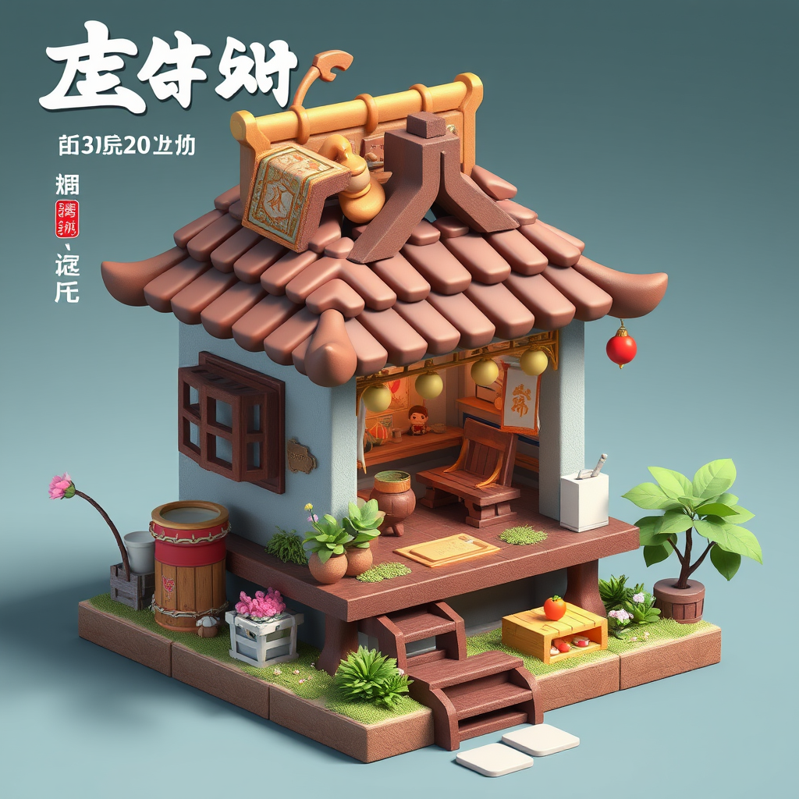

# ComfyUI画像生成・画像編集の検証記録

- 実験日：2026-11-10〜11（JST）
- 記録日：2026-11-11
- 関連記録：[PC・WSLの環境構築](desktop_ai_setup_report.md)、[ディレクトリREADME](README.md)
- 情報源：利用者が共有した管理画面の観測・処理時間・GPU測定値と、Windows内の既存PNG・保存済みワークフローJSONの読み取り確認。
- 今回の保存作業では、追加生成、モデル取得、ComfyUI更新、既存環境の変更は行っていない。

## 1. 目的

RTX 5070 Ti 16GBのPCでComfyUIを起動し、FLUX.1 Schnellによる画像生成、日本語・英語プロンプトの固定シード比較、FLUX.2 Klein 4Bによる新規生成と参照画像編集を試す。生成できること、所要時間、メモリ使用、指示に対する出力を記録する。

処理時間・VRAM・温度は利用者共有値であり、今回再測定していない。PNGから確認したのは実画像、解像度、プロンプト、実行グラフ、モデルファイル名等で、PNGに処理時間・GPU測定ログは埋め込まれていなかった。

## 2. PC・ソフトウェア環境

| 項目 | 実験時の構成・確認範囲 |
|---|---|
| OS | Windows 11 |
| GPU | NVIDIA GeForce RTX 5070 Ti、VRAM 16GB |
| システムRAM | 32GB |
| Comfy Desktop | 1.1.9（インストール時の観測） |
| ComfyUI | v0.44.2（管理画面での観測） |
| PyTorch | 2.12.1+cu130（管理画面で確認） |
| 実行方式 | Local / Public Builds / NVIDIA |
| 保存場所 | Comfy Desktopの共有ディレクトリの`models`、`output` |
| 更新 | 最新版への更新は未実施。記載バージョンを推測で変更しない |

このPyTorchはWindows側のComfy環境の記録であり、既存レポートにあるWSLの`ai-lab`（PyTorch 2.14.1+cu130）とは別環境。PNGのノードに記録された`cnr_id`・`ver`や`frontendVersion`も、今回管理画面で観測したComfyUI/PyTorchの実行バージョンへ読み替えない。

## 3. 導入と発生したエラー

1. WindowsへComfy Desktop 1.1.9を導入し、Local / Public Builds / NVIDIAの構成でインスタンスを作成した。
2. 初回は通信エラー`ERR_CONNECTION_RESET`で環境作成に失敗した。
3. その後インスタンスを作り直し、正常に起動した。通信エラーの根本原因は未特定で、ネットワーク設定等を変更したとは記録しない。
4. 管理画面でComfyUI v0.44.2とPyTorch 2.12.1+cu130を確認した。
5. 共有保存先のモデル・出力を使用し、SchnellとKleinの画像生成・編集を実施した。

保存確認では、指定されたWindowsの共有出力先が実在したため、保存先を推測する必要はなかった。公開用の表記はユーザー名を含めず、以下とする。

```text
%LOCALAPPDATA%\Comfy-Desktop\ComfyUI-Shared\output
%LOCALAPPDATA%\Comfy-Desktop\ComfyUI-Shared\models
```

WSLから指定されたWindows側のディレクトリを読み取った。インストーラー、Python環境、モデル本体は保存対象に含めていない。

## 4. FLUX.1 Schnellの設定と生成結果

PNGの実行グラフで次の設定を確認した。

| 項目 | 設定 |
|---|---|
| タスク | Text to Image（入力画像なし） |
| 解像度 | 1024×1024、batch size 1 |
| ステップ | 4 |
| CFG | 1.0 |
| Guidance | `CLIPTextEncodeFlux`の設定値3.5 |
| サンプラー / スケジューラー | euler / simple |
| denoise | 1.0 |
| 拡散モデル | `flux1-schnell.safetensors` |
| テキストエンコーダー | `clip_l.safetensors`、`t5xxl_fp16.safetensors` |
| VAE | `ae.safetensors` |

利用者の測定では初回生成が**28.34秒**、ウォームアップ後は**約7〜8秒**。初回と定常時を別に記録し、差の全てをモデルロード時間とは断定しない。

`ComfyUI_00001_.png`は出力フォルダー内で最も古いSchnell画像で、初回生成の保存候補として採用した。レトロカーとピンクの花を確認できる。ただし、処理時間の実行ID付きログは今回提示されておらず、28.34秒とこのファイルの厳密な対応は未検証。


## 5. 日本語・英語プロンプトの比較

### 固定条件とプロンプト

`ComfyUI_00005_.png`と`ComfyUI_00006_.png`の実行グラフはいずれもシード**123456789**で、前節の設定とモデル構成を使用していた。プロンプト以外の主要な生成パラメーターは一致している。

日本語の`clip_l`：

```text
淡いミントグリーンの小さなレトロカー、ピンク色のコスモスの花、パステルカラー、かわいい3Dイラスト、柔らかな光、シンプルな黄緑色の背景
```

日本語の`t5xxl`：

```text
淡いミントグリーンの小さなレトロカーが、画面中央に横向きで停まっている。車の窓からピンク色のコスモスの花がたくさんあふれている。背景はシンプルな淡い黄緑色。柔らかな春の日差しが車と花を照らしている。かわいい3Dイラスト風で、車全体が見える構図。背景に人や他の車は存在しない。
```

英語の`clip_l`：

```text
A small mint-green retro car, pink cosmos flowers, pastel colors, cute 3D illustration, soft lighting, simple pale green background
```

英語の`t5xxl`：

```text
A small mint-green retro car is parked sideways in the center of the image. Many pink cosmos flowers are overflowing from the car's windows. The background is simple and pale green. Soft spring sunlight illuminates the car and flowers. The scene has a cute 3D illustration style, with the entire car visible in the composition. There are no people or other cars in the background.
```

### 共有された測定値

| 項目 | 日本語 | 英語 |
|---|---:|---:|
| 生成時間 | 7.73秒 | 7.53秒 |
| 最大VRAM使用量 | 15,694 MiB | 15,658 MiB |
| 最高GPU温度 | 49℃ | 50℃ |

最大GPU使用率は100%との共有結果。計測器・サンプリング間隔・処理時間の厳密な計測区間は今回未確認であり、これらをPNGの埋め込み情報から得た値とは扱わない。

| 日本語入力の出力 | 英語入力の出力 |
|---|---|
|  |  |

両方で画像ファイルの生成には成功したが、今回確認した日本語入力の画像は**文字状の模様を伴う建物風の出力で、車の指示に沿っていなかった**。英語入力ではミント色の車とピンクの花が確認できる。この1回ずつの観測を、言語全体の品質・速度・モデル能力の差へ一般化しない。反復測定、別シード、別プロンプトによる評価は未実施。

## 6. FLUX.2 Klein 4BのText to Image

保存PNG`Flux2-Klein_00001_.png`は**1024×1024**。埋め込みの幅・高さも1024であり、画面表示の違いより実ファイルの情報を優先した。

保存時の実行グラフで`LoadImage`や参照画像の経路がないことを確認した。プロンプトに「色を変更し、構図を維持する」という表現があっても、元画像を渡していないため**新規生成**である。

| 項目 | PNGの実行グラフで確認した構成 |
|---|---|
| 拡散モデル | `flux-2-klein-base-4b.safetensors` |
| テキストエンコーダー | `qwen_3_4b.safetensors`、type `flux2` |
| VAE | `flux2-vae.safetensors` |
| ステップ / CFG | 20 / 5.0 |
| サンプラー / スケジューラー | euler / Flux2Scheduler |
| 実行時シード | 0（PNG内の値） |
| 処理時間 | 約36.17秒（利用者共有値） |

実行に使われたファイルは名前に`base`を含むモデル。保存されたキャンバスには別の`flux-2-klein-4b.safetensors`の枝もあるが、この出力の実行モデルと混同しない。

```text
Change the car's color from mint green to pastel pink.
Keep the car's shape, the flowers, the composition, and the background unchanged.
```

結果はピンク色の車と白い花を配した画像。ミント色の元画像を編集した結果ではなく、新たな車・花・背景が生成された。


## 7. FLUX.2 Klein 4BのImage Edit

実行グラフの保存出力へつながる`LoadImage`は`ComfyUI_00006_.png`を参照していた。英語固定シード比較で生成したミントグリーンの車が編集元であり、公開保存でも同じPNGを使用する。

指示：

```text
Change only the car color from mint green to pastel pink. Keep the flowers, composition, camera angle, and background unchanged.
```

| 項目 | PNGの実行グラフで確認した構成 |
|---|---|
| 拡散モデル | `flux-2-klein-base-4b-fp8.safetensors` |
| テキストエンコーダー | `qwen_3_4b.safetensors`、type `flux2` |
| VAE | `full_encoder_small_decoder.safetensors` |
| ステップ / CFG | 20 / 5.0 |
| サンプラー / スケジューラー | euler / Flux2Scheduler |
| 実行時シード | 1111443136920027 |
| 入力処理 | `ImageScaleToTotalPixels`、1.0 megapixels、nearest-exact |
| 参照経路 | VAEEncode → ReferenceLatent（正・負のconditioningへ接続） |
| 出力解像度 | 1024×1024（PNG実寸） |
| 処理時間 | 43.92秒（利用者共有値） |

新規生成とはモデルファイルとVAEが異なるため、単に参照画像の有無だけを切り替えた比較ではない。

| 編集前（英語Schnell出力） | 編集後（Klein） |
|---|---|
|  |  |

車体の主要な色がピンクになり、車の向き、主要な構図、花と背景は概ね維持された。一方で、花の細かな配置やホイール周辺の色も変化しており、**車の色以外を完全に固定できたわけではない**。定量的な画像差分や画質指標は測定していない。

## 8. 生成速度・VRAM・品質の整理

| 実験 | 処理時間（共有値） | 最大VRAM（共有値） | 今回の実画像確認 |
|---|---:|---:|---|
| Schnell初回 | 28.34秒 | 未確認 | 最古の保存PNGを候補として保存 |
| Schnellウォーム後 | 約7〜8秒 | 測定別の値のみ | 定常時の反復数は未確認 |
| Schnell日本語・固定シード | 7.73秒 | 15,694 MiB | 建物風の出力。車の指示には不一致 |
| Schnell英語・固定シード | 7.53秒 | 15,658 MiB | ミント色の車と花 |
| Klein新規生成 | 約36.17秒 | 未確認 | ピンク色の車、新規構図 |
| Klein画像編集 | 43.92秒 | 未確認 | 色変更成功、細部にも変化 |

モデル、ステップ数、CFG、VAE、入力の有無、プロンプト、ウォーム状態が揃っていないため、表の所要時間だけでモデルの優劣を判定しない。KleinのVRAM・GPU温度・最大GPU使用率は未確認で、Schnellの測定値を転用しない。

## 9. 保存ファイルと再現手順

### 対応づけと日時

Windowsの作成日時を読み取り、JSTへ換算した。日時はファイルシステムの観測値であり、生成時間の検証には使わない。

| 保存PNG | 役割 | Windows作成日時（JST、秒まで表示） |
|---|---|---|
| [ComfyUI_00001_.png](comfyui/images/ComfyUI_00001_.png) | 初回出力候補 | 2026-11-11 06:23:44 |
| [ComfyUI_00005_.png](comfyui/images/ComfyUI_00005_.png) | 日本語、シード123456789 | 2026-11-11 06:38:26 |
| [ComfyUI_00006_.png](comfyui/images/ComfyUI_00006_.png) | 英語、シード123456789、編集前 | 2026-11-11 06:39:45 |
| [Flux2-Klein_00001_.png](comfyui/images/Flux2-Klein_00001_.png) | Klein新規生成 | 2026-11-11 09:22:30 |
| [Flux2-Klein-4b-base_00001_.png](comfyui/images/Flux2-Klein-4b-base_00001_.png) | Klein編集後 | 2026-11-11 09:55:00 |

モデル、プロンプト、シード、参照経路で対応づけたPNGのみ採用した。`ComfyUI_00002_.png`〜`00004_`は今回の固定シード比較ではないため追加しない。初回候補以外についても、時間・GPU測定ログの実行IDとPNGを照合したわけではない。

個別に保存されていた次の3JSONも、内容を変更せずコピーした。PNGから新しくワークフローを作ったと主張するものではない。

- [flux_schnell_full_text_to_image.json](comfyui/workflows/flux_schnell_full_text_to_image.json)
- [image_flux2_klein_text_to_image.json](comfyui/workflows/image_flux2_klein_text_to_image.json)
- [image_flux2_klein_image_edit_4b_base.json](comfyui/workflows/image_flux2_klein_image_edit_4b_base.json)

JSONの元保存先は`%LOCALAPPDATA%/Comfy-Desktop/ComfyUI-Installs/ComfyUI/ComfyUI/user/default/workflows`。PNGとJSONのSHA256・サイズ、PNGの日時・解像度・実行モデル・参照画像の対応は[artifact_manifest.json](comfyui/artifact_manifest.json)に記録した。画像5枚＋JSON3件の合計は5,089,764 bytes（約4.85 MiB）。

### 再現する場合の手順（今回は未実行）

1. 実験時のComfy環境を用意し、各節で確認したモデル・エンコーダー・VAEを対応するカテゴリへ配置する。本リポジトリに重みや環境は含めていない。
2. 保存済みのワークフローJSONを読み込む。各PNGにも`workflow`と実行グラフ`prompt`が残っているため、測定対象画像のプロンプト・シードはPNG側を確認する。
3. Schnellの日英比較は第5節の2エンコーダー入力を設定し、シード123456789、4ステップ、CFG 1.0等を固定する。初回候補は別プロンプト・別シードであり混ぜない。
4. Klein新規生成は入力画像なしのbaseモデル側の枝を使う。編集は`ComfyUI_00006_.png`をComfyの入力画像として指定し、第7節のモデル・プロンプトを使う。
5. 保存キャンバスには未使用のテンプレート枝がある。編集ワークフローの`pink_tone_chair.png`は今回の車の保存出力に接続していない入力であり、その画像はコピーしていない。車の枝だけを対象にし、不要な枝は読み込み後に無効化等を確認する。
6. 保存JSONには`randomize`やサブグラフの`proxyWidgetErrorQuarantine`が残る。次回実行前にシード制御とリンクを確認し、PNGの実行値を基準にする。保存JSONの再実行は今回未検証で、読み込み直後の無操作で同じ結果になるとは保証しない。

### 公開前の確認

選択したPNGを目視し、全テキストメタデータと保存JSONを点検した。公開対象に秘密値・個人識別情報・ユーザー固有の絶対パスは見つからなかった。PNGのチャンクは`IHDR`、`tEXt`、`IDAT`、`IEND`で、埋め込み文字列は`prompt`と`workflow`。JSON内の文字列も確認し、個人設定・認証情報・モデル本体はコピーしていない。

PNGとJSONは原本とバイト一致するコピーで、メタデータや画像の加工はしていない。SHA256とPNGチャンクCRCを検査した。公開対象はこの記録、READMEの追記、画像5枚、ワークフロー3件、検査したファイルのmanifestのみ。

## 10. 限界と次の作業

- 言語比較は各1回。速度差・品質差を一般化せず、今回の日本語入力の指示不一致も観測として残す。
- 再生成、反復測定、画質の定量評価は未実施。モデルファイルの内容・ハッシュや実行環境一式も固定していない。
- Kleinでは新規生成と編集でモデル・VAEが異なる。未測定のVRAM等を推定で埋めない。
- 更新は未実施。ワークフローのテンプレートに更新案内が含まれていても、更新したことにはしない。
- **次の優先タスクはWan 2.2 TI2V-5Bでの動画生成**。まず約3秒で初回検証し、成功後に約5秒へ進め、生成時間・VRAM・画質を記録する。
- 動画生成は未実施で、成功・モデル導入済みとは扱わない。今回動画生成を開始していない。
