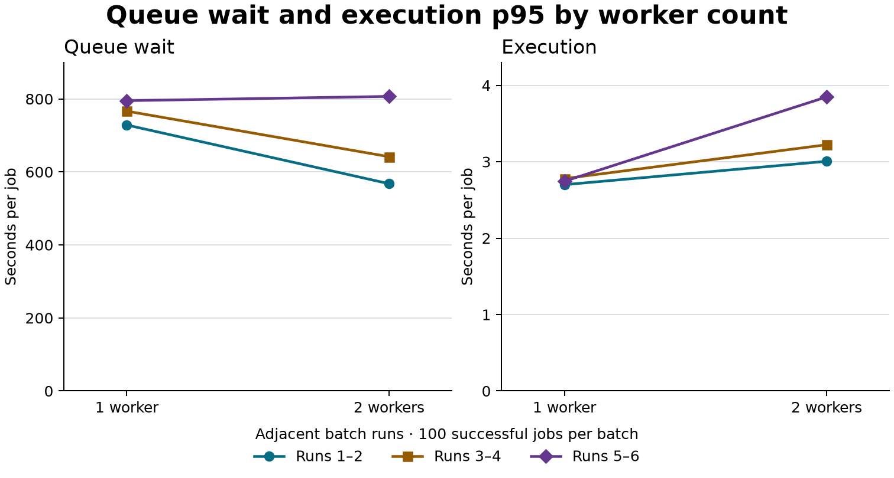

# P5の比較実験と再現手順

## 1 Workerと2 Workerの比較

専用のLinux開発環境で実行する。Python 3.12と固定依存、Docker Engine、Compose v2、ジョブのcgroup v2制限、CPU統計 `/proc/stat` と `/proc/pressure/cpu` を利用する。同一のDocker daemon上でDBとジョブを動かし、計測時に別の負荷試験を重ねない。[環境の準備](../../README.md#python環境とテスト)

```bash
# 261117/ci_runner から実行
mkdir -p artifacts
.venv/bin/python scripts/compare_workers.py --pilot --output artifacts/p5-pilot.jsonl
.venv/bin/python scripts/compare_workers.py --output artifacts/p5-comparison.jsonl
```

出力は既存ファイルを上書きしない。各回の環境・生データをJSON Linesに保存し、全回の終了と専用DBの回収後に `complete` を記録する。
試験専用のComposeプロジェクトにランダムな名前を付け、DBを `127.0.0.1:55418` に置く。使用中なら起動は失敗し、既存接続先へ切り替えない。
別の `DATABASE_URL` は使わない。停止時はWorkerをドレインして専用DBを回収する。ハード停止後の確認では、その試験のrun IDまたはComposeプロジェクト名で資源を特定する。

| 項目 | 条件・測り方 |
|---|---|
| 負荷 | 固定 `fixture-v1` の成功モード。1/2 Workerを `1, 2, 2, 1, 1, 2` の順で各3回。同じ100個の合成commit SHAを1 transactionで待機キューに入れる |
| ウォームアップ | 各回の開始前に各自のWorker構成で2件成功させる。測定対象の100件から除外。Docker build cacheは保持する |
| 実行経路 | GitHub HTTP応答を試験用データに置換。取得物の検証、固定Docker build、claim、Docker制限、DBでの結果・ログ・成果物確定は常駐Workerの通常経路 |
| キュー待ち p95 | DB上の `started_at - claimable_at`。対象runがキューに今すぐ入れる時刻からclaimまで。取得とbuildの時間も入り得る |
| 実行 p95 | Workerの単調時計でDockerの起動から終了確認まで。準備、回収とDB commitを含まない |
| バッチ所要時間 | DB上のキュー投入時刻から、最後の正式resultの終了時刻まで |
| DB待ち | およそ0.5秒ごとに `pg_stat_activity` を読み、実行中のCI Runner接続のwait eventを数える。接続の発行前や短い待ちを取りこぼし得る |
| CPU競合 | Workerホストの `/proc/stat` 差分のbusy、iowait、steal、CPU PSIの `some` 増分。ホスト全体の値を使い、CPUを待つタスクが一つでもあった時間を区別する |
| 合格条件 | 100件に試行各1件、同一SHA・固定digestに結びついた正式成功、ログと結果JSON、計測値を確認。試験対象コンテナ・imageを回収する |

p95は各回の成功サンプルで線形補間する。失敗件数を別に数え、異常終了・計測値の欠落・資源残存があれば比較を停止する。
短い固定fixtureの結果は、Docker準備・終了処理やDBの競合を含めた当環境の観測値。キャッシュがない初回、ネットワーク経由のGitHub、他のジョブへの適用は別に測る。

### 2026-11-19の実測

AMD Ryzen 7 7735HS、WSL2 Linux 6.6.87.2、8論理CPU・約27.4 GiB RAM、Python 3.12.3、Docker Engine 29.9.2、PostgreSQL 17.12（migration 001〜008）を使用した。
実行コードは `649dbd4f01abc6a98de071244879841633d4e8e7`。比較スクリプトのSHA-256は `cb4388faa5dcec2b8b298a550d23b8ad6f787bfdc8733bca395f86479921204c`。

- Pythonベースイメージは `python:3.12-slim-bookworm@sha256:935c3c5b12357a7e10caa9c1e6ca5692344d97cf229832ef584be2cec9fc03df`。
- PostgreSQLイメージは `postgres:17.12-bookworm@sha256:40865bc877a289da75963d97d72b59633f639fc5af7a4e856bfa3714cae5b536`。
- `fixture-v1` のSHA-256は `9c567875e01f89cc15eb23d1b3d2d40c2c23239cc414ff12a1b1c3902dd3f7ff`。同じ固定Dockerfileを全回で使った。

| 実行順 | Worker | 正式成功 / 失敗 | キュー待ち p95（秒） | 実行 p95（秒） | バッチ所要（秒） | CPU busy / iowait | CPU PSI some（秒） | DB観測回数 / WalSync |
|---:|---:|---:|---:|---:|---:|---:|---:|---:|
| 1 | 1 | 100 / 0 | 728.439 | 2.699 | 799.125 | 52.0% / 3.3% | 115.51 | 1,573 / 1 |
| 2 | 2 | 100 / 0 | 567.699 | 3.005 | 595.757 | 62.3% / 3.9% | 159.23 | 1,178 / 1 |
| 3 | 2 | 100 / 0 | 641.698 | 3.222 | 686.851 | 67.9% / 3.3% | 192.13 | 1,356 / 3 |
| 4 | 1 | 100 / 0 | 766.448 | 2.779 | 813.574 | 51.3% / 3.1% | 114.71 | 1,615 / 3 |
| 5 | 1 | 100 / 0 | 795.113 | 2.744 | 849.695 | 50.6% / 2.4% | 125.23 | 1,685 / 1 |
| 6 | 2 | 100 / 0 | 806.831 | 3.848 | 852.616 | 66.0% / 3.9% | 231.54 | 1,686 / 6 |

600件のrunは試行各1件で正式成功し、同じSHA・固定digest・image ID・ログ・結果JSONの対応を確認した。
2 Workerの3回はどちらのWorkerも毎回50件を確定した。測定対象とウォームアップのコンテナ・image、専用DB資源は回収した。
CSVのサンプル番号は合成SHAでソートした順。各回の100件を個別に再集計でき、image IDにはrun別の由来ラベルが含まれる。[600件の実測サンプル](p5-worker-samples.csv)



グラフはCSVの `queue_ms` と `execution_ms` を実行順の各100件で集計したp95。線は時系列で隣接する1・2回目、3・4回目、5・6回目を結ぶ。縦軸はそれぞれ秒で、範囲が異なる。

1 Workerと2 Workerの各3回の中央値を比べると、キュー待ちp95は766.448秒から641.698秒（約16%減）、実行p95は2.744秒から3.222秒（約17%増）、バッチ所要は813.574秒から686.851秒（約16%減）だった。最後のペアでは2 Workerが約3秒遅かった。
2 Workerの全回でCPU busyとCPU待ちの時間が増えた。Docker起動・実行の競合は実行p95の増加と整合するが、ホスト統計では処理段階や他プロセスの影響を分離できない。
DBの合計9,093回の観測で待ちイベントは `IO/WalSync` 15サンプル、ロック待ちは0サンプルだった。観測間の短い待ちや接続確立はこの回数に含まれない。

## 初回のローカル検証

手元の専用開発環境にリポジトリを取得し、検証対象のcommitを選んで、READMEのvenv作成と固定依存の導入を行う。
既存DBの設定やGitHubの認証情報を用意せず、以下のコマンドでローカル固定fixtureの成功を確認する。ポート `55417` は試験専用に空ける。

```bash
# 261117/ci_runner から実行
PYTEST_ADDOPTS='-k "test_api_to_separate_worker_to_persisted_result and fixture_success" -rP' \
  .venv/bin/python scripts/verify_execution.py
```

受付APIで保存したrunを別Workerプロセスで取得して固定fixtureをDockerで実行する。APIを起動し直して正式結果とログを照会し、同じ要求から新しいrunが増えないことを検査する。
成功は該当テストのPASS、readiness 200、DB再起動後のmigration保持、専用資源の回収で判断する。
2026-11-19に同一ホストの一時アーカイブと新しいvenvで、PyPIから固定依存を導入して再現した。別ホストの第三者による確認は残る。

担当ブランチでは、使い捨てのUbuntu 24.04 VMで同じ初回検証を実行する。毎回新しいvenvへ固定依存を導入し、実PostgreSQLと実Dockerでローカル固定fixtureを1件確認する。
試験がskipされて証拠が生成されない場合や、証拠のSHAとcheckoutのSHAが異なる場合は失敗とする。
通常CI、GitHubの実配送、第三者による手順の確認はそれぞれ別に記録する。[クリーン環境検証の実行一覧](https://github.com/kenobix/Claude_practice/actions/workflows/ci-runner-clean-fixture.yml)

## 3分の障害デモ

Dockerの固定イメージが既にある状態で始める。端末AでDBのない管理画面、端末Bで実DB・Dockerを使う故障試験を開く。

```bash
# 端末A
env -u DATABASE_URL .venv/bin/python -m uvicorn ci_runner.app:app --host 127.0.0.1 --port 18117
```

```bash
# 端末B
PYTEST_ADDOPTS='-k "test_two_residents_recover_after_sigkill and running" -rP' \
  .venv/bin/python scripts/verify_execution.py
```

| 目安 | 操作と確認 |
|---|---|
| 0:00–0:30 | 端末Bで試験を開始し、ブラウザーの `http://127.0.0.1:18117/ui/demo` で過去のデモを開く。コミットSHA、失効した試行1、正式結果の試行2を確認する |
| 0:30–1:30 | 試験は固定GitHub応答を検証し、コンテナのGO直後に1つ目のWorkerを強制停止する。DB時刻の30秒leaseを待ち、DB記録と完全IDの照合を経て残存コンテナを回収する |
| 1:30–2:30 | 代替Workerがバックオフ後に同じrun・同じSHAを取得する。試験は代替の試行中と正式確定後の両方で旧tokenの結果を拒否し、履歴と正式結果を検査する |
| 2:30–3:00 | 端末Bで復旧秒数とPASS、readiness、専用DBの回収を確認する。ブラウザーの過去デモと、今回の実測を区別する |

45秒は復旧の仮目標。イメージ取得、ディスク待ち、監視周期で実際の時間は変わる。出力が揃うまで待ち、超過や失敗を記録する。
2026-11-19の復旧は45.91秒。初回検証と過去デモの表示テストを含む選択回帰3件とDBの起動から回収までは113.51秒だった。
このデモで使う投入は試験用のrunで、GitHub pushの実配送は承認済み公開HTTPS受信先の確保後に別途確認する。[P3実配送と手動再送](webhook.md#起動と障害復旧)

## 運用と限界

- 受け付け状況はreadinessとrun履歴を照合する。API応答が途切れた手動投入は同じ業務キーで再送する。外部Webhook配送は管理者がGitHubから再送する。[受付API](intake-api.md)
- Worker停止・DB断では、新規取得に進めない。停止位置によっては期限監視と回収が必要。Docker create結果が不明なら不在を推測せず、再実行を保留する。[期限と回収](design.md#失効attemptのコンテナ回収)
- ログと成果物のpayloadに容量上限がある。自動保持期限と複数ホストはMVP対象外。異常時は運用指標から当該runの試行へ戻って調べる。[管理画面と指標](run-operations.md)
- 管理APIはloopback、Webhookは専用入口、ジョブは固定fixtureだけをDockerの制限下で実行する。管理用のDB、Docker socket、認証情報をジョブと分離する。[脅威モデル](threat-model.md)
