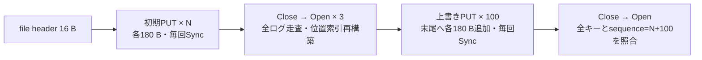

# 段階4: 同期PUT・再Open・Goヒープの計測

本計測は人工データのLinux実DBを使う。エンジン・形式v1・毎更新同期の契約は変更しない。
`inspect`と固定seed参照モデルは既存実装を利用し、[段階3の検証](stage3-acceptance.md)を引き継ぐ。

## 実行手順とデータの扱い

module内で実行する。`--work-dir`は既存ディレクトリを指定するが、その中の既存DBは開かない。
各件数で新規の`kvbench-*`ディレクトリを作り、その配下だけに人工DBを書き、終了時に自分のディレクトリだけを削除する。
異常強制終了では専用ディレクトリが残る可能性があるため、利用者の既存データを混ぜず専用親を使う。

```sh
make build
bench_parent=$(mktemp -d ../.tools/kvbench-parent.XXXXXX)
./bin/kvbench --work-dir "$bench_parent" \
  --keys 1000,10000,100000 --value-bytes 128 \
  --open-samples 3 --update-samples 100 > /tmp/kv-measurement.json
# exit 0とJSONの各cases[].verified=trueを確認する
rmdir "$bench_parent"
```

ビルド済みCLIから実行し、race detectorや他のテストを同時に走らせない。
本体の引数・計測定義は[main_linux.go](../cmd/kvbench/main_linux.go)、正常・境界・異常系は
[main_linux_test.go](../cmd/kvbench/main_linux_test.go)を参照。
exit 0は全測定・再読取照合・閉鎖・専用DB清掃・JSON出力完了、2は入力不正、1は実行/出力失敗。
失敗時に不完全な測定を成功結果として出さない。JSON出力の短いwriteも失敗とする。
通常DB・バイナリ・機械生成の生サンプルはGitへ追加しない。生JSONは上記の出力先で取得できる。

## 条件と測定区間

| 項目 | 定義 |
|---|---|
| キー・値 | ASCII固定16 B `key-000000000000`から順番に生成。初期値128 Bの0x5a、上書き値は同長の0xa5。全値を再読取照合 |
| 初期データ | 新規DBへ1千/1万/10万件のPUT、毎回File.Sync。投入時間は報告指標に含めない |
| Open時間 | 初期投入後のClose→Openを同一プロセスで3回。Open呼出しの直前から返却直後までの経過ns。LOCK取得、DB/親dir Sync、検証と索引再構築を含む |
| 更新待ち時間 | 再OpenしたDBで100回の既存キーPUT。Put直前〜返却直後、CRC/encode/write/File.Sync/索引公開を含む。キー整形・値準備・Close・stdoutは含めない |
| Goヒープ | 各Open前のGC後HeapAllocと、Open後にDBを生存させたGC後HeapAlloc。差分を符号付きbyteで報告。GC/ReadMemStatsはOpen時間の外 |
| 正解確認 | 各Open後と、上書き後Close→Open後に全キー・値・件数・最新sequence・PUT件数・ログ長を照合。確認は測定区間の外 |
| キャッシュ | OSページキャッシュを残す同一プロセスの再Open。投入直後から暖まっており、cold start・CLIプロセス起動時間の測定ではない |
| 容量 | `16 + (キー数+上書き数) × (32+16+値長+4)`を事前計算し、256 MiB超をI/O前に拒否 |

Goヒープ差分は索引・キー等の生存Goオブジェクトの概算で、純粋な索引サイズ、RSS、プロセス全体、OSページキャッシュではない。
ランタイムの揺れを含むため負値もそのまま報告する。採取GCを更新ループ中には明示的に挟まず、通常の自動GCは有効。
各件数は同じプロセス内で昇順に実行する。CPUの固定やOSキャッシュの削除、全体設定の変更は行わない。



上書きでもログは増える。既存レコードの置換やコンパクションは行わない。

## JSONスキーマ（version 1）

- `started_utc`、`environment`にGo/OS/arch/kernel/CPU/論理CPU数/GOMAXPROCS/FS種別、GOGC/GOMEMLIMIT環境値、build時のrevision/dirtyを記録。
  空のGC環境値は明示的な上書きなし。FSのmount source/optionsは別途`findmnt -T`で記録する。
- `key_bytes`、`value_bytes`、`sync`、`cache`で全件数に共通の条件を示す。
- `cases[]`に`keys`、初期/最終ログbyte、`opens[]`（経過ns、GC後の前/生存heap byteと差分）、
  `update_nanoseconds[]`（各PUTの経過ns）、`verified`を保存する。単位はfield名に含める。
- 生の全サンプルを出す。百分位を計算する場合は集計方法を併記する。少数サンプルに統計的有意差を主張しない。
- バイナリのbuild情報は測定対象ソースの追跡用。未commitでbuildすれば直前revision＋dirty=trueとなる。

## CIと検証範囲

`make check`のfmt/vet/testは新規cmdも含み、buildで`bin/kvbench`も生成する。既存専用CIで実行される。
小規模の実DB試験は1/3キー、0/128/1 MiB値、2回Openと4回上書きで、キーの周回も照合する。
不正入力・容量限界の両側・既存ファイル保持・不正な作業親・短いstdout・専用DB清掃、件数が正常でも値が違うログの拒否も検査する。
CIは実Linuxファイルを使うが、1千/1万/10万件の性能測定は自動では実行しない。
Dockerや外部DBの検証は追加していない。電源断・ホスト停止・装置flushは依然未検証。

## 初回実測

2026-11-17、開始13:05:00 UTC。Go 1.27.4 linux/amd64、Ubuntu 24.04.4 LTS、
WSL2 kernel 6.6.87.2-microsoft-standard-WSL2、AMD Ryzen 7 7735HS with Radeon Graphics。
ゲスト論理CPU 8、GOMAXPROCS=8、GOGC/GOMEMLIMITの環境上書きなし。
保存先はworktree内の`.tools`にmktempで作った専用親、ext4 (`0xef53`)、`/dev/sdd`。
mount optionsはrw,nosuid,nodev,relatime,discard,errors=remount-ro,data=ordered。
Windowsホストの実装置・他負荷・仮想ディスクcacheやCPU周波数は制御/計測していない。

測定buildは基準revision `00c550ea7c3ba19becfe92add11b54d22d143240` + 未commitの計測実装（dirty=true）。
実行バイナリSHA-256: `b9f33bc7a128f6181b9c415a6aeaf9c5cd3760218c9cc59059afe63ca6b11543`。
生JSONは `/tmp/kv-stage4-measurements.json` に出力し、Gitには含めない。
全ケースverified=true、exit 0、専用DBと親の清掃成功。

| キー数 | 初期→最終ログ B | Open 3標本 ms（実行順） | Heap差分中央値 B | PUT p50 / p95 µs |
|---:|---:|---|---:|---:|
| 1,000 | 180,016 → 198,016 | 4.844354 / 6.806166 / 4.697078 | 97,160 | 2,167.128 / 2,556.227 |
| 10,000 | 1,800,016 → 1,818,016 | 53.933590 / 58.779668 / 44.990533 | 814,968 | 2,423.592 / 3,851.160 |
| 100,000 | 18,000,016 → 18,018,016 | 535.433774 / 515.562117 / 511.833444 | 6,846,728 | 3,042.944 / 4,862.579 |

PUTは各100標本を昇順に並べたnearest-rank、順位ceil(p×100)（1始まり）を使う。
heap中央値は各3標本の中央。ログ長は理論式と実DBのreportで一致した。
この条件ではログ増加に伴い再Open時間と生存Goヒープ差分が増えた。1回の実行条件の記述であり、
他環境で同じ時間になる保証、性能優劣、p99/長時間の安定性、電源断耐性を示す結果ではない。
1 MiB値は小規模の境界テストだけで、この性能表の値長はすべて128 B。

## 段階4の完了判定と次の単位

元計画のinspect項目は実装済みで、3 seedの復旧参照モデル照合も段階3で実施済み。
今回、容量内の3件数について同期条件・CPU/FS・値長・件数・キャッシュ・測定区間を揃えた実行手順、
機械可読な生サンプル出力、上の実測表とログ増加の図を整備した。
**段階4はここで定義したwarm再Open・同期PUT・Goヒープ指標の範囲で完了**と判定する。
環境間の性能比較やcold start、RSSの計測は実施していない。

次の最優先は段階5の人工データによる正常再起動・不完全末尾復旧・途中破損拒否の3〜5分デモと、
第三者が実行できる読み順/保証/制限/設計判断の整理。新たなエンジン機能を追加しない。
MVP全体は段階5が未完了。完成後は発展課題へ自動で進まず、独立レビューを提案する。
