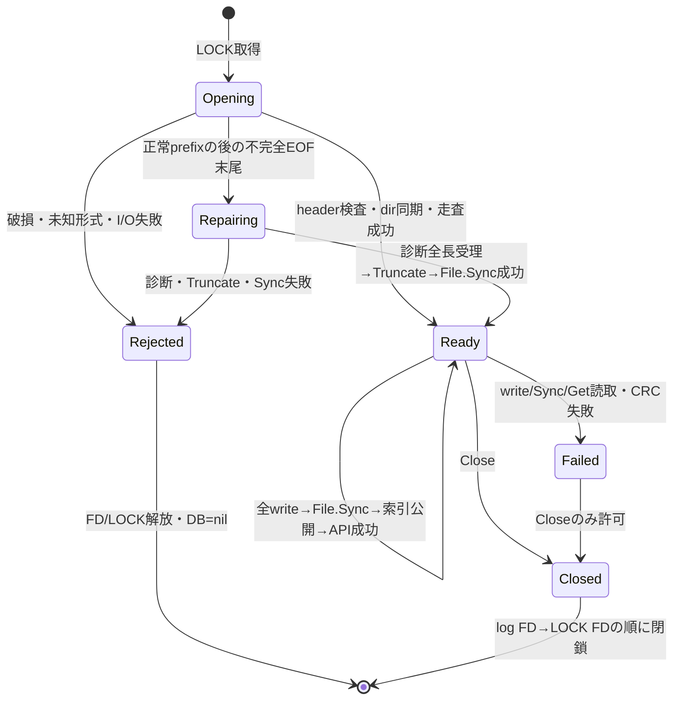

# MVP受入条件の照合

2026-11-21 JST。[元計画](../../../261014/plan_database_engine.md)の最初の完成範囲と段階0〜5を最終照合した。
最終レビュー対象の実装・テストは `3f9e622d90829882fe065f72873e423bf2a5eb10`。
下記の導入再現は `b0152c4b36deb88b36c8d93e459624e8b6156ea8` を対象とした過去の記録。

## 最終判定

**段階0〜5の受入条件を満たし、Linuxの単一writer永続KVエンジンのMVPは完成。**
基準 `4d854e4` の独立レビューで指摘された3件は実装側で修正し、回帰試験を実施した。
基準 `02f67bd` の独立再レビューで見つかった探索権限の回帰を修正した。
`TestDeniedDirectoryTraversal` はLinuxが探索を拒否する経路で既存ログの不変と新規ファイルの未作成を確認する。
`TestOpenDirectorySyncPaths` は同期するFDのファイルIDを照合し、実親のSync失敗時にOpenが失敗することを確認する。
修正後の独立再レビューはCritical・High・Medium・Low各0件で、技術的受入を可とした。
対象SHAの[push CI](https://github.com/kenobix/Claude_practice/actions/runs/44866877780)と
[PR CI](https://github.com/kenobix/Claude_practice/actions/runs/44866882386)も成功した。
本人による書面での設計説明は3問とも合格。PR #2のマージ承認は別途求める。

| 計画の条件 | 実装・検証根拠 | 判定・境界 |
|---|---|---|
| 段階0: 入出力、形式、失敗時の方針 | [API](api.md)、[形式](file-format.md)、[耐久性](durability.md)、[公開hex](../tests/fixtures.md) | 仕様・バイト例を整備し、独立レビューで確認 |
| 段階1: 不在/空値/上書き/削除、入力上限、不正長の拒否 | recordの `TestRoundTrip` / `TestInvalidHeadersBeforeBodyAllocation` / `TestAllTruncations`、engineの `TestReferenceModel` / `TestKeyBoundaries` / `TestValueBoundaries`、fixture往復一致 | 実テストで確認。UTF-8キー1〜256 B、NUL不可、値0〜1 MiB。有限の入力検証であり全入力の証明ではない |
| 段階2: 更新→同期→索引公開、再起動、単一writer | engineの `TestSyncOrdering` / `TestOpenDirectorySyncPaths` / `TestDiskReferenceModelAcrossReopens` / `TestLockProcess`、CLIの `TestPersistentCLIProcesses` | 実ファイルと別プロセスで確認。相対パスと実親の同期失敗を追加検証。ライブラリAPIはinternal内で利用可能 |
| 容量上限と失敗後の状態 | `TestCapacityAndSequence` / `TestOversizedLogRejected` / `TestDiskWriteAndSyncFailures` / `TestCompoundIORecovery` | ログ256 MiB、sequence枯渇の明示拒否。容量境界は疎ファイル、ENOSPC/EIOは注入であり実媒体枯渇ではない |
| 段階3: 成功履歴、未応答操作、末尾復旧、破損時停止 | [受入表S3-1〜10とレビュー後の回帰](stage3-acceptance.md)、[復旧診断](recovery-diagnostics.md)、[応答境界](cli-response-experiments.md) | 定義したプロセス障害とI/O注入モデルで検証。全故障・全スケジュールや電源断は未検証 |
| 段階4: inspect、固定seed照合 | recoveryの `TestScanBoundaries`、engineの `TestSeededCrashRecovery`、CLIの実プロセス試験 | 検証済みprefixの件数/sequence/削除数/サイズ/位置、3 seedの辞書一致を確認 |
| 段階4: 起動/更新/メモリの計測と条件 | [計測手順・生JSONの定義・実測表・ログ図](measurement.md) | 1千/1万/10万キーで実測済み。warm Open・毎PUT Sync・Goヒープ。cold start/RSS/他環境比較は未測定。今回は大規模計測を繰り返さない |
| 段階5: 正常/停止復旧/途中破損の3デモ | [デモ](demo.md)、`TestDemoProductProcesses` / `TestDemoRejectsMissingBinary` | 製品CLI、実SIGKILLハーネス、別DBのfixtureコピーを区別。3〜5分は説明順の目安 |
| 段階5: 読み順、設計判断、保証、制限、振り返り | [README](../../README.md)、[設計判断](design-decisions.md)、下記状態図 | 整備済み。走査/索引・毎回/まとめ同期・停止/修復の判断を記載 |
| 段階5: クリーン環境から導入・再現 | 下記の再現手順と実行記録、[専用CI](ci.md) | ソース・toolchain・キャッシュを分離した検証と、新規runnerの検証を区別して記録 |
| 段階5: 本人が書込み順を説明できる | 下記の本人による書面回答 | **合格** |

## 状態と成功の境界



通常Openで新規ログを作る場合は、完全なファイルheaderのwriteとFile.Syncも必要。
CLIの応答はAPI成功後のClose成功→stdout全長受理→exit 0。
同期後のClose/出力失敗や応答前停止でも、更新全体が再Openで見え得る。
inspectは別の読み取り専用走査であり、上図の修復経路を通らない。

## 管理対象ソースからの再現手順

これは別worktreeを作らず、`git archive`で専用一時領域にソースだけを展開する手順。
通常DB、既存toolchain、Goキャッシュ、未追跡ファイル、Gitメタデータを持ち込まない。
Linux x86_64/ext4、Python 3、gcc、GNU Make、sh/curl/tar/sha256sumなどのOS側ツールは必要。
ネットワークは公式Goアーカイブ取得時だけ必要で、Go moduleの外部依存はない。

リポジトリルートから、確認したcommitを明示して実行する。

```sh
acceptance_root=$(mktemp -d /tmp/kv-acceptance.XXXXXX)
git archive b0152c4b36deb88b36c8d93e459624e8b6156ea8 261118 | tar -x -C "$acceptance_root"
cd "$acceptance_root/261118/kv-engine"
sh scripts/setup-go.sh
# 回線制約がある場合は取得済みの公式アーカイブを同じSHA-256で再照合できる
# sh scripts/setup-go.sh /path/to/go1.27.4.linux-amd64.tar.gz
# Gitメタデータを含まない配布ソースとしてbuild（このシェル内だけ）
export GOFLAGS=-buildvcs=false GOPROXY=off GOSUMDB=off
./scripts/go-env.sh go version
make check
./scripts/go-env.sh go test -race -count=1 -timeout=3m ./...
make demo
```

既存worktreeのキャッシュを持ち込まず `make check` を実行する。内包するデモ統合試験も実行対象。
`-buildvcs=false` はVCS情報の埋込みだけを無効化し、テストのassertionや同期処理を無効化しない。
配布ソースのrevisionは上記commitとアーカイブhashで外部から記録する。通常worktree/CIの設定は変更しない。
追加の `make demo` はREADMEの第三者向け入口からの実行確認で、テスト件数には二重加算しない。
実行後、記録はGit外へ保管し、自分で作った一時ソース・toolchain領域だけを清掃する。
同じホストの新規領域は新しいOSや第三者による独立検証とは異なる。

## 今回の実行結果

2026-11-17、Ubuntu 24.04.4 LTS / WSL2、kernel 6.6.87.2-microsoft-standard-WSL2、
Linux x86_64、/tmpのext4（/dev/sdd）、Python 3.12.3、gcc 13.3.0、GNU Make 4.3。
GitアーカイブSHA-256は `d4c5b0baa2231994cde64e40b4403cb2ef2f5d2b1c7c9fd263b474144f024593`。
管理対象57ファイルを展開し、.git/.tools/binが含まれないこと、終了時も57ファイルが同じであることを確認した。

| 実行 | 観測と判定 |
|---|---|
| 公式Goのオンライン取得 | 約180秒でcurl exit 28。70,680,823 B中12,686,565 Bでタイムアウト。**失敗**として記録。中途stagingはsetupのtrapで清掃 |
| アーカイブ指定セットアップ | 既存の取得済み公式アーカイブ70,680,823 Bをsetupで再照合。SHA-256は[開発手順](development.md)と一致し、新規領域へのGo 1.27.4導入が成功。既存インストールはコピーしない |
| 初回make check（VCS無効化前） | vet成功。engine/record/recovery/kvbenchは成功。cmd/kvの3 Testとtestsの1 Testは子build時のVCS情報取得で失敗。**全体は失敗**。build targetには到達しない |
| 原因と再現条件の調整 | 親の `/tmp/.git` が存在するが有効なGitリポジトリではなく、Goの自動VCS情報取得がexit 128。親は変更しない。アーカイブ検証だけGOFLAGS=-buildvcs=falseを明示。DB仕様・assertion・Goソースは変更なし |
| 調整後make check | fmt検査/vet/test/両CLI buildが成功。全6パッケージ成功（初回で成功した4パッケージは新設キャッシュの結果を再利用）。初回失敗2パッケージは再実行して成功 |
| race detector | -race -count=1 -timeout=3m、全6パッケージ成功。通常buildの製品CLI/ネストした選択ハーネスまでrace付きとは扱わない |
| make demo | exit 0、3 scenario_pass、2実SIGKILL、最後のdemo_passでcleanup=true/power_loss_verified=false |
| 正常/停止復旧 | 別プロセスGETでバイナリ/空値を保持。after_ackはack=6/sequence=6・275 B、partial_bodyはack=5/sequence=5・268→229 B |
| 不完全/破損fixture | 別DBの不完全末尾64→54 B、k=v、次GET診断なし。破損はoffset=16、exit 5を繰返し、全91 B不変 |

新規テスト関数や新しいfuzz探索は追加せず、既存の受入試験を導入再現のために使用した。
この実行の通常テストはパッケージ単位の出力で記録し、passイベント件数は採取していない。
基準commitの既存417 pass/0 fail/0 skipというJSON記録を、この新しい実行の採取件数と混同しない。
実行ログは `/tmp/kv-acceptance-{setup,offline-setup,check,check-retry,race}.log` と
`/tmp/kv-acceptance-demo.jsonl`（Makeのコマンド表示も含む、Git外）。専用一時ソース/toolchainは確認後に清掃。

同じWSLホストの分離領域なので、OS側ツール・カーネル・FSは既存環境を共有する。
別の新規GitHub runnerでは基準commitの[push CI](https://github.com/kenobix/Claude_practice/actions/runs/44092543548)・
[PR CI](https://github.com/kenobix/Claude_practice/actions/runs/44092559373)が成功し、
公式Goの取得/照合、fmt/vet/test/build/race（Python/製品CLI/実SIGKILLを含む）を確認済み。
これはローカルのオンライン取得失敗を成功に置き換えず、第三者本人の説明確認や電源断検証の代用にもしない。
最終受入を記録した最新SHAのCI結果は、Draft PR #2のChecksに記録する。

## 本人による書面での設計説明

本人の初回回答とQ2への追加回答を、実装・停止試験・復旧仕様と照合した。以下は本人回答の要約と合格理由。

| 項目 | 判定 | 本人回答と照合結果 |
|---|---|---|
| Q1 永続化の順序 | 合格 | 全バイト書込み → File.Sync成功 → 索引更新 → Close成功 → CLI応答。初回はログの内容に加え、DB内のログ名と親にあるDBの名前を保存するため両ディレクトリを同期する。[耐久性仕様](durability.md) |
| Q2 応答前の異常終了 | 合格 | Sync成功後の停止では未応答の4件目まで完全に反映、sequence 4を要求する。全バイト書込み後にSync結果が不明なら、応答済み3件の状態とsequence 3、または4件目まで完全に反映した状態とsequence 4を許容する。応答済みの操作列を保持し、部分反映や状態とsequenceの不一致を拒否する。これはOS・FSが生存するプロセス停止モデルでの判定。[段階3の故障モデル](stage3-acceptance.md#故障モデルと正解) |
| Q3 ログの復旧 | 合格 | 検証済み部分に続く実末尾のErrIncompleteのみが修復候補。診断全バイトをエラーなく出力してから、正常境界に切り詰めて同期する。短いファイルヘッダーとCRC不一致は内容を変えず起動拒否。[耐久性仕様](durability.md#復旧とinspect) |

実機電源断、ホスト停止、WSL・装置flush、診断先の永続化は未検証。
