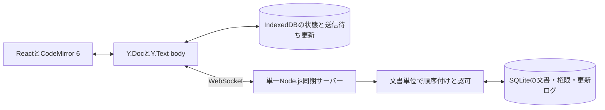
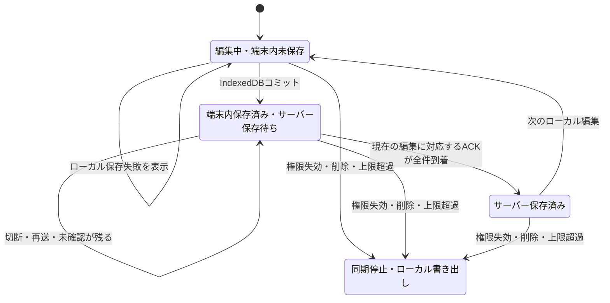
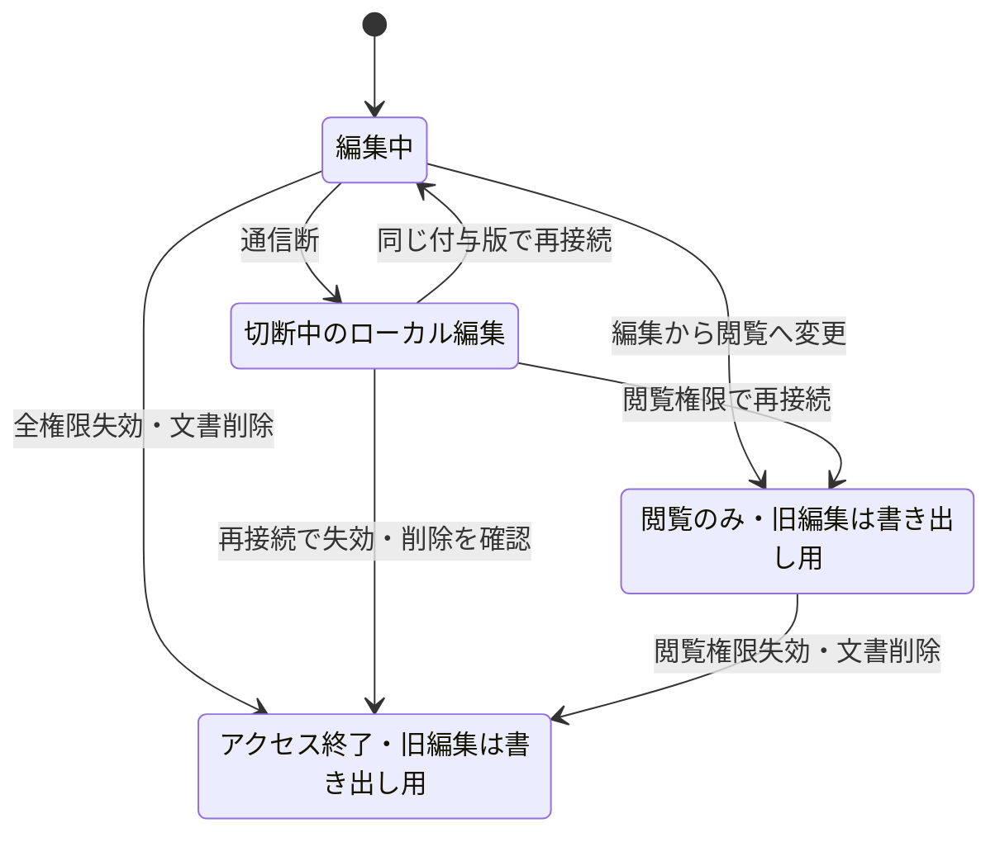

# 共同編集アプリの仕様と設計

2026年11月25日のPhase 0で定めたMVPの仕様。実装と試験の予定は [受入条件](acceptance.md) に記す。 [元計画](../../261014/plan_collaborative_editor.md)

## 利用範囲と権限

事前登録した3つのデモ用アカウントで、プレーンテキスト文書を作成、一覧表示、編集、論理削除する。文書IDはサーバーが発行し、再利用しない。1文書につき閲覧者を含めてWebSocket接続を3本まで受け付ける。閉じた接続とタイムアウトした接続は枠を解放する。公開登録、公開招待、初回のオフライン起動、リッチテキスト、コメント、編集履歴UI、複数サーバーはMVPの範囲外とする。

| 操作 | 所有者 | 編集者 | 閲覧者 | 権限なし |
| --- | --- | --- | --- | --- |
| 一覧に表示・本文を取得 | 可 | 可 | 可 | 不可 |
| 本文を更新 | 可 | 可 | 不可 | 不可 |
| 他の利用者の権限を変更・文書を削除 | 可 | 不可 | 不可 | 不可 |

ログイン済みの利用者は文書を作成でき、作成者が所有者になる。MVPでは所有者を移譲しない。HTTPとWebSocketは同一オリジンで提供し、サーバー側のセッションと `HttpOnly` のセッションCookieを使う。認証と文書の権限に加え、WebSocketの `Origin` と状態変更HTTP要求のオリジンを照合する。端末が申告した表示名を認可に使わない。

## 更新と同期

本文は `Y.Text('body')` で管理し、CodeMirrorの差分をYjsのトランザクションに反映する。受信更新には別の `transaction.origin` を付け、クライアントの送信待ち一覧へ入れない。本文はテキストとして表示する。Awarenessでは接続中の利用者とカーソルを扱う。利用者の表示名は認証済み接続にひも付け、AwarenessはDBに保存しない。同一ブラウザのタブ間で本文を直接同期する経路は設けない。

WebSocketは1接続につき1文書を扱う。アプリ独自のバージョン付きメッセージを使い、本文にはYjsのバイナリ更新形式V1、Awarenessには `y-protocols` を使う。HTTP APIがログイン、文書の一覧・作成、権限変更、削除を受け付ける。Phase 1の通信テストでメッセージのエンコードとHTTPのパスを固定する。

| メッセージ | 方向 | 内容 |
| --- | --- | --- |
| `HELLO` | 端末→サーバー | プロトコル版、端末の送信元ID `client_id` |
| `STATE` | サーバー→端末 | 現在のロール、文書の権限版、利用者の `grant_revision`、Yjsの完全状態、受理順番号。復帰時は端末がこの完全状態からstate vectorを求める |
| `UPDATE` | 端末→サーバー | `client_id`、`message_id`、付与版 `grant_revision`、Yjs更新。差分同期から生成した更新にも使う |
| `APPLIED` | サーバー→端末 | サーバーが受理した更新と受理順番号。他端末は番号順に反映する |
| `ACK` | サーバー→送信端末 | DBに保存した更新の `client_id`、`message_id`、受理順番号。Phase 2から使う |
| `AWARENESS` | 双方向 | 一時的な接続・カーソルの情報 |
| `ERROR` | サーバー→端末 | 理由コードと、更新に対応する場合はそのID。認可や接続の失敗では接続を閉じる |

サーバーは認可と文書のロードが済んでから `STATE` を返す。スナップショット取得と購読開始を同じ文書の処理列で行い、その時点より後の `APPLIED` を続けて送る。端末が配信の連番欠落を検出したら、再接続して `STATE` から復帰する。送信元にも新規の `APPLIED` を届けるため、全購読者が同じ番号を追える。

## 保存と再送

| データ | 保存する情報 |
| --- | --- |
| 文書 | `document_id`、所有者ID、`active` / `deleted`、権限版、作成日時 |
| 権限 | `document_id`、`user_id`、ロールまたは権限なし、`grant_revision`、変更日時 |
| 更新ログと受理記録 | 文書・利用者・送信元・メッセージのID、SHA-256、文書内の受理順番号、受理日時。更新ログにはYjsバイナリを含める |
| スナップショット | 文書ID、包含する受理順番号の上限、Yjsの完全状態、作成日時 |
| 端末内データ | 利用者ID・文書ID・付与版別のYjs状態と、未確認更新のID・送信順・バイト列 |

文書ごとに更新、権限変更、削除を直列に処理する。更新には次の手順を適用する。

1. 更新受理時にセッション、文書の状態、編集権限と付与版、サイズと頻度を検査する。同期から生成した差分にも同じ検査を行う。
2. `(document_id, user_id, client_id, message_id)` を受理記録で引く。同じIDとSHA-256なら既存の `ACK` を返す。IDが同じでハッシュが異なる場合は `MESSAGE_ID_CONFLICT` を返す。
3. 正式な状態のコピーに更新を適用する。本文の型とサイズ、完全状態のサイズを検査する。保留中の構造や削除が残れば `MISSING_DEPENDENCY` を返し、依存する更新をまとめた同期を要求する。破損や形式違いは `INVALID_UPDATE` を返す。拒否時は正式な状態とDBを変更しない。
4. 更新と受理記録を同じトランザクションでコミットする。コミット成功後に正式なサーバー状態へ反映し、配信と `ACK` を送る。コミット結果が不明な場合や正式な状態への反映に失敗した場合は、同じDBを使う文書の接続を閉じる。DBから状態を読み直してから再接続を受け付ける。

Yjs状態が変わらない更新にも受理記録を残し、その時点の受理順番号で `ACK` を返す。新しい受理順番号の割り当てと `APPLIED` の配信は、Yjs状態を変えた更新に限る。 [Phase 2の保存と復旧](phase2-storage.md)

SQLiteはローカルの永続ストレージに置き、`journal_mode=WAL`、`synchronous=FULL`、`foreign_keys=ON` を使う。復元ではスナップショットの受理順番号より後の更新ログを適用してから接続を受け付ける。スナップショットのYjs状態と受理順番号は同じトランザクションで保存する。ログを整理する場合は、そのスナップショットに含まれる行だけを削除する。受理記録は更新本体と分けて保持し、ログ整理後も再送を判定できるようにする。 `ACK` の耐久性は同じDBを使うプロセス再起動で試験する。 [SQLiteの設定](https://www.sqlite.org/pragma.html#pragma_synchronous)

端末はIndexedDBの同じトランザクションでYjs状態と送信待ち更新を保存し、完了後に `UPDATE` を送る。再送には元のIDとバイト列を使い、対応する `ACK` が届いたらその項目だけを削除する。復帰時に片方の保存データが欠けていれば、保存済みの `Y.Doc` と残っている送信待ち更新を合成して、サーバーのstate vectorから不足更新を生成する。削除だけの変更も含めて `UPDATE` で送る。先行更新の欠落で再送が拒否された場合も、新しい `STATE` を取得して同じ手順で復帰する。復帰用更新に新しいIDを付け、未確認の元の項目はそれぞれの `ACK` を受けてから消す。state vectorの一致で完了を判定しない。 [削除更新の実験](../work_log.md#削除だけの更新)

接続状態と保存状態は別に表示する。「サーバー保存済み」は、現在のローカル編集がすべて `ACK` で確認され、ローカル未保存分もない場合に表示する。Phase 1はメモリ上でのオンライン同期までとし、端末内保存・保存待ち・サーバー保存済みの表示はPhase 2で導入する。Phase 1のデモデータは文書一覧と本文をまとめて揮発扱いにする。

## 権限変更と文書削除

権限変更のコミットで文書の権限版を更新し、権限が変わった利用者の `grant_revision` を進めて既存接続を閉じる。失効と再付与の間で版を再利用しない。閲覧者への変更を確認した端末は、サーバーから読み直した文書を閲覧用の `Y.Doc` に表示する。削除した文書のIDでは `STATE` を返さない。失効・削除を確認した端末は旧版の未送信内容を同期から隔離し、理由とテキスト書き出しを表示する。再付与時の編集は現在版から始める。サーバーはセッションが期限切れになった接続を閉じる。端末は同じ利用者の再ログイン後に付与版を再確認する。

閲覧・編集の失効はサーバーからの今後の配信と更新受理に適用する。ログアウト時は同期とローカル書き込みを止め、そのアカウントのキャッシュを破棄してから別の利用者の文書を開く。既に取得済みのコピーを遠隔消去する機能は対象外とする。

## 上限とエラー

| 項目 | 上限または判定 | 超過・拒否時の動作 |
| --- | --- | --- |
| 可視本文 | `Y.Text.length` で100,000 UTF-16コード単位。上限を含む | `TEXT_LIMIT`。正式状態を保ち、端末にローカル書き出しを案内 |
| Yjs更新と完全状態 | それぞれ8 MiB（8,388,608バイト）。上限を含む | `UPDATE_LIMIT` / `STATE_LIMIT`。更新受理または同期を止める |
| WebSocketメッセージ | 8 MiBのバイナリと最大1,024バイトのヘッダー。圧縮を無効にする | メッセージを破棄してサイズ超過で接続を閉じる |
| 更新頻度 | 同一利用者・文書につき平均10件/秒、最大20件のバースト | `RATE_LIMIT`。端末は送信待ちを保持し、待機後に再送 |
| 接続 | 文書につき3本。セッションと文書の権限が必要 | `ROOM_FULL` / `SESSION_EXPIRED` / `ACCESS_DENIED`。接続を受け付けない |

本文の長さ、受信した更新のバイト数、変更後の完全状態のバイト数を個別に測る。削除済み文書については、削除時に閲覧権限があった利用者に `DOCUMENT_DELETED` を返せる。権限がない利用者への応答では、存在しない文書と閲覧できない文書を区別しない。破損、重複、制限の試験では、拒否された更新や再送で本文が変わらないことを確認する。 [受入条件](acceptance.md)
