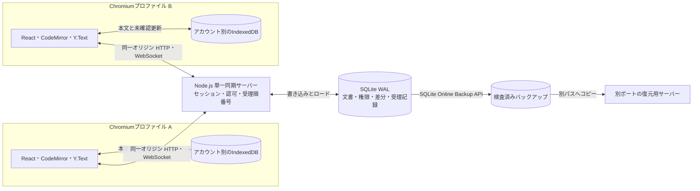

# 起動、バックアップ、復元

## システム構成



通常は `127.0.0.1:4173` で待ち受けます。ブラウザのURLには起動時に表示されたアドレスを使います。文書・権限・受理記録はSQLiteに残ります。セッションはプロセスのメモリにあるため、再起動後は起動時に表示されたパスワードでログインし直してください。 [起動手順](../README.md#アプリを起動する)・[保存の仕様](phase2-storage.md)

## バックアップを取得する

以下は `261125/app` で実行します。ソースを `COLLAB_DATABASE` で変更した場合は、実際に稼働中のファイルを指定してください。バックアップ先の親ディレクトリは、自分だけがアクセスできる場所に作成します。

```bash
umask 077
backup_dir=$(mktemp -d)
npm run backup -- data/collab.sqlite "$backup_dir/editor.sqlite"
sha256sum "$backup_dir/editor.sqlite"
```

サーバーは稼働中でも構いません。コマンドはソースを読み取り専用で開き、SQLite Online Backup APIでコミット済みの状態を別ファイルに取得します。作成したファイルを単独で扱えるようにジャーナルモードをDELETEへ変更し、`integrity_check` と `foreign_key_check` が通ったファイルだけを新しい名前で出力します。出力先の既存ファイルは上書きしません。稼働中のWALデータベースのメインファイルだけを `cp` で保存すると、WALにあるコミット済みの変更を取りこぼす場合があります。 [SQLite Online Backup API](https://www.sqlite.org/backup.html)

取得後にファイルのハッシュと取得時刻を保存します。バックアップには削除済み文書や履歴も残るため、DBと同じ範囲にアクセスを制限してください。ブラウザの未確認更新と起動中のセッションは、バックアップに含まれません。 [端末内の下書き](phase3-access.md#端末の下書きとログアウト)

## 停止して復元を確認する

1. 計画停止では編集者にサーバー保存状態を確認してもらいます。未確認の変更が必要な場合は、端末をログアウトする前に本文または下書きを控えます。
2. 本番に相当するローカル運用を切り替えるときは、旧サーバーを起動したターミナルで `Ctrl+C` を押し、プロセスの終了を待ちます。旧DBとその関連ファイルを残します。下記の別ポートで復元を試すだけなら、旧サーバーは稼働したままで構いません。
3. バックアップのSHA-256を取得時の記録と照合し、別ディレクトリへコピーします。コピー先を `COLLAB_DATABASE` に指定して起動します。

```bash
sha256sum "$backup_dir/editor.sqlite"
restore_dir=$(mktemp -d)
cp "$backup_dir/editor.sqlite" "$restore_dir/collab.sqlite"
COLLAB_DATABASE="$restore_dir/collab.sqlite" PORT=4174 npm start
```

4. 新しいブラウザプロファイルで `http://127.0.0.1:4174` を開き、復元用サーバーが表示したパスワードでログインします。所有者の一覧と共有設定、本文と受理順番号を取得時の記録と照合します。閲覧者の別プロファイルでは本文を読めること、編集が無効であること、削除済み文書が一覧に出ないことを確認します。
5. 確認後に復元用プロセスを停止します。取得したバックアップは保持し、試験用のコピーとプロファイルは用途を確認してから回収します。

専用の一時実行で、本文・共有設定・付与版・受理順番号と、スナップショット、後続ログ、整理済みの操作の受理記録を照合します。 [復元の自動試験](../app/tests/phase4.spec.ts)・[観測結果](acceptance.md#phase-4の受入結果)

## 古いバックアップに戻す場合

復元範囲は取得時点のコミット済みDBです。それ以降に受理した更新、権限変更、削除は復元されません。取得時点で削除済みだった文書は削除済みのままです。取得後に削除した文書を取得時点へ戻すと、当時の状態が復元されます。

同じオリジンと旧プロファイルを使うと、取得後の状態や未確認更新がIndexedDBに残っている場合があります。付与版が一致すれば保存状態から差分が再生成されることがあり、受理記録も復元時点までしかありません。履歴の世代を区別して端末の再参加を止める機能はありません。古いバックアップからの復元を確認するときは、別ポートと新規プロファイルを使ってください。切り替える前に、取得後の権限変更や削除を運用記録と照合してください。
