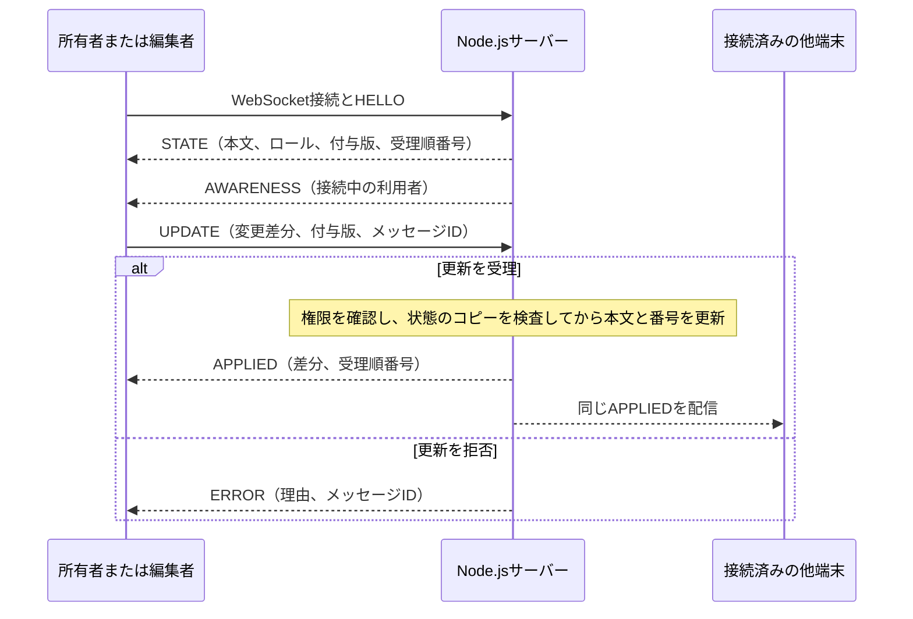

# Phase 1の通信仕様

Node.jsは `127.0.0.1` で待ち受け、画面とHTTP API、WebSocketを同じオリジンで提供する。セッションCookieには `HttpOnly` と `SameSite=Strict` を指定する。状態を変えるHTTP要求とWebSocketの接続時に `Origin` を照合する。 [MVPの仕様・設計](design.md)

## HTTP API

| メソッドとパス | 内容 |
| --- | --- |
| `GET /api/session` | 選択できるアカウントと現在の利用者を返す。未認証の場合は `user: null`。 |
| `POST /api/session` | `userId` と `password` を検証し、セッションCookieを発行する。 |
| `DELETE /api/session` | セッションを無効にし、同じセッションで開いたWebSocketを閉じる。 |
| `GET /api/documents` | 利用者に閲覧権限がある文書の `id`、`title`、`role` を返す。所有者には変更できる権限設定も返す。 |
| `POST /api/documents` | `title` を受け取り、呼び出した利用者を所有者として文書を作る。 |
| `PUT /api/documents/:id/access/:userId` | 所有者だけが `role` に `editor`、`viewer`、`null` を指定できる。実際に変更した場合は対象利用者の付与版を進め、その利用者の既存接続を閉じる。 |

## WebSocket

接続先は `/ws/:id`。WebSocketに切り替える前にセッション、文書の閲覧権限、接続数を検査する。未認証はHTTP 401、権限なしや異なる `Origin` はHTTP 403、3接続を使用中の文書への追加接続はHTTP 409を返す。閲覧者の接続も1枠と数える。WebSocketを閉じたときと、サーバーが応答停止を検出したときに枠を解放する。

バイナリメッセージの先頭2バイトには、JSONヘッダーの長さをビッグエンディアンで入れる。その後にUTF-8のJSONヘッダーとバイナリデータが続く。長さの2バイトを含むヘッダーは最大1,024バイト。 `STATE`、`UPDATE`、`APPLIED` のバイナリデータにはYjs V1形式を使い、上限は8 MiBとする。 `AWARENESS` は `y-protocols` の形式を使い、サーバーが接続にひも付く表示名を設定する。

サーバーは初期状態を送った接続に、続く変更を受理順に通知する。文書状態に変更がない更新には新しい受理順番号を割り当てない。クライアントは受信更新を適用するときに `transaction.origin` に受信用の値を指定し、ローカルの変更だけを `UPDATE` で送る。連番の欠落や更新拒否を検出した場合は同期を止める。「接続し直す」を選ぶと、サーバー上の現在の `STATE` を取得する。

Phase 1の `APPLIED` が示すのはサーバーのメモリに反映した番号である。永続化後に返す `ACK` はPhase 2で導入する。 [受入結果](acceptance.md#phase-1の受入結果)
