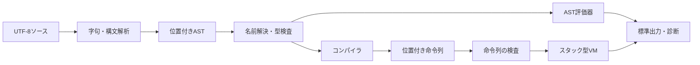

# 自作言語とVM

整数と真偽値を持つ小さな言語を作ります。同じプログラムを構文木（AST）の直接評価とスタック型VMで実行し、標準出力と診断を比較します。 [元計画](../261014/plan_language_vm.md)

Phase 0〜3で言語仕様と固定期待値を定め、解析器、AST評価器、コンパイラ、スタック型VMを実装しました。Phase 4では生成プログラムによる照合と段階別の性能計測を行い、再現手順とデモを作成しました。

- [言語仕様と処理系の構成](docs/language_spec.md)
- [バイトコード命令仕様と命令数の計算](docs/bytecode.md)
- [実行例の読み方と受入条件](docs/acceptance.md)
- [入力例](examples/)と[期待値](examples/expected.json)
- [一致性検証](docs/verification.md)と[性能計測](docs/benchmark.md)
- [3分デモ動画](demo/language-vm.mp4)と[台本](demo/storyboard.md)
- [計画の確認と作業ログ](work_log.md)

## 処理系の構成



両処理系は値の型タグ・演算・出力上限を共有します。AST評価器はノードをたどり、VMは命令列を実行します。

## CLIの使い方

リポジトリのルートから `261126/` に移動し、Python 3.12で実行します。追加パッケージは不要です。

```bash
cd 261126
python3 -m tiny_language --tokens examples/arithmetic.tiny
python3 -m tiny_language --ast examples/arithmetic.tiny
python3 -m tiny_language run --engine ast examples/sum_loop.tiny
python3 -m tiny_language run --engine vm examples/sum_loop.tiny
python3 -m tiny_language --disassemble examples/sum_loop.tiny
python3 -m tiny_language run --engine vm --trace examples/sum_loop.tiny
python3 -B -m unittest discover -s tests -v
```

`--tokens` はEOFを含むトークンの配列を、`--ast` は構文木をJSONで標準出力に表示します。トークンには元の文字列とソース位置があり、ASTの各ノードには対応するトークンがあります。ASTの整数値は長い整数の桁を保てる10進文字列です。

どちらのオプションも入力エラーと字句エラーを検出し、`--ast` は構文エラーも検出します。該当するエラーでは標準エラー出力にJSONの診断を1件出し、終了コードは2です。診断位置は1始まりの行・列と、0始まりで終端を含まないUTF-8バイト範囲です。 [Phase 1の受入記録](docs/acceptance.md#phase-1の受入記録)

`run --engine ast PATH` と `run --engine vm PATH` はプログラム全体の名前解決と型検査を終えてから実行します。上の合計例の標準出力は、どちらも `15` と `6` の2行です。

診断は標準エラー出力に書きます。実行前にソースの誤りを検出した場合は標準出力が空で、終了コードは2です。実行時エラーでは成功済みの出力が残り、終了コードは3です。処理系内部の不具合では `E_INTERNAL` と終了コード4を返します。 [Phase 3の受入記録](docs/acceptance.md#phase-3の受入記録)

`--disassemble PATH` は命令番号、命令名、オペランド、元ソースの位置をJSON配列で標準出力に表示します。`run --engine vm --trace PATH` は命令が成功するたびに、命令と実行後のスタック、変数スロットへの書き込みをJSONで1行ずつ標準エラー出力に書きます。`print` の出力先は標準出力です。 [逆アセンブルとトレース](docs/bytecode.md#逆アセンブルとトレース)

## クリーンな環境での再現

以下はクローンのルートから実行する手順です。テストには固定例、資源上限の境界、seed `261126` の生成例60件が含まれます。再計測の結果は実行環境によって異なります。

```bash
cd 261126
lang_check=$(mktemp -d)
python3 -m venv "$lang_check/venv"
lang_python="$lang_check/venv/bin/python"
"$lang_python" -B -m tiny_language run --engine ast examples/sum_loop.tiny
"$lang_python" -B -m tiny_language run --engine vm examples/sum_loop.tiny
"$lang_python" -B -m unittest discover -s tests -v
"$lang_python" -B -m tools.compare --seed 261126 > "$lang_check/comparison.json"
cmp results/comparison.json "$lang_check/comparison.json"
"$lang_python" -B -m tools.benchmark --warmups 4 --repeats 15 --output "$lang_check/benchmark.json"
```

デモは字幕付き・無音のMP4です。再生成する場合は別途FFmpeg（`drawtext` と `libx264`）、Noto Sans CJKとDejaVu Sans Monoを用意し、同じディレクトリで次を実行します。動画には保存済みの計測結果と、その場で取得したCLI出力を使います。

```bash
"$lang_python" -B -m tools.demo --output "$lang_check/language-vm.mp4"
```

## 既知の制約

- 言語は `int` と `bool`、変数、ブロック、分岐、反復、出力を対象とします。関数、再帰、配列、文字列、JIT、独自GC、Webプレイグラウンド、外部バイトコードの読み込みはMVPの範囲外です。
- AST評価器はノードへの進入を、VMは停止命令を含む命令を数えます。実行上限で止まる位置と、それまでの出力は処理系によって異なることがあります。
- 動作確認はLinux x86_64のCPython 3.12で行いました。性能は記録した環境と3入力に限った測定結果です。 [MVP受入記録](docs/acceptance.md#phase-4とmvpの受入記録)
