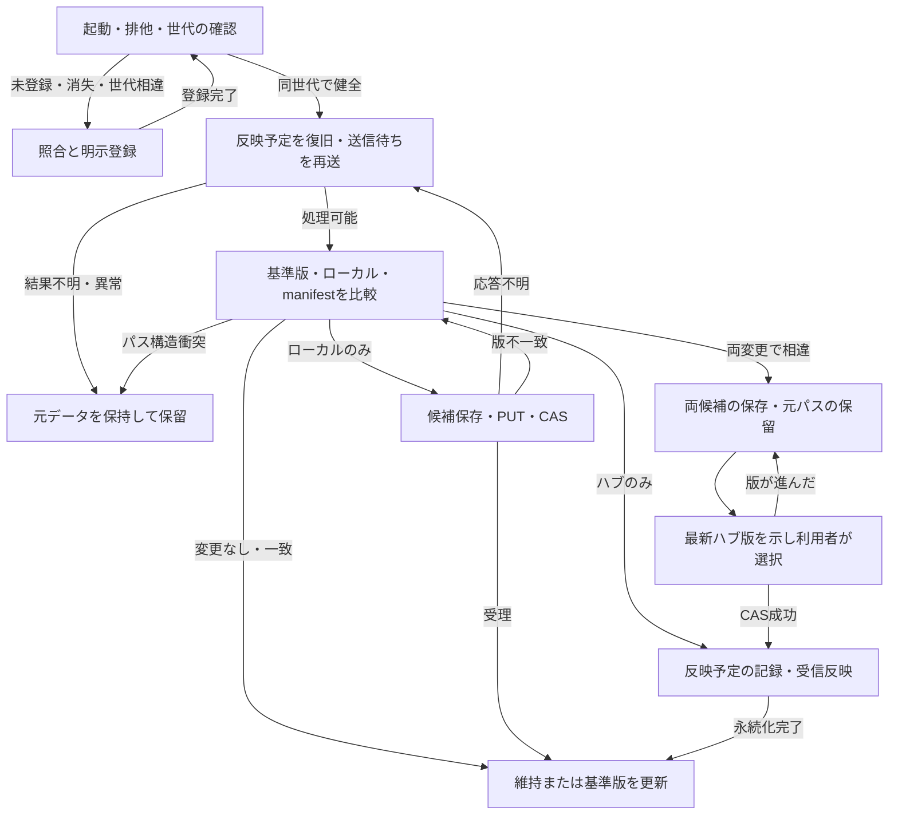

# 同期の状態遷移と復旧設計

ハブ1プロセスとクライアント2プロセスを、LinuxまたはWSL2のLinuxファイルシステム上で動かす。利用者は同期、登録、解決、再起動時の復旧が終わるまで対象フォルダの編集を止める。空ディレクトリ、所有者、権限、拡張属性は同期しない。名前変更は旧パスの削除と新パスの作成で伝え、それぞれに版が付く。操作単位は1パスで、同期全体の一括コミットは行わない。

この設計にはMVP全体の処理を含む。起動と初回登録は[ハブ同期の手順](hub-sync.md)、競合と再登録は[端末の操作手順](conflicts.md)を参照する。

## パスとファイルの境界

- パスは相対パス。区切りは `/` で、正規化をせず受理前に検査する。絶対パス、空文字、空要素（先頭・末尾の `/` を含む）、`.`・`..`、NUL、バックスラッシュ、Unicodeの制御文字（カテゴリCc）を拒否する。UTF-8のエンコードが正しいUnicodeスカラー値を認める。大文字・小文字、NFC・NFDは別名とする。
- 1要素255バイト、全体1,024バイト（区切り込み）、深さ32要素を上限とする。完全一致する `.file-sync` 要素は管理用に予約する。ルート直下の管理領域だけを検証の上で走査から除外し、ほかの位置の予約名は拒否する。ローカル走査で不正な名前・種類やI/Oエラーを見つけたら、通常の送受信前にその回を停止する。列挙できない状態をファイルの不存在として使わない。
- ハブ上の生存パスは、区切り単位の祖先・子孫を同時に持てない。tombstoneは名前を占有しない。クライアントでは、作成先をふさぐ実ファイル、ディレクトリ内の別ファイル、管理対象外の空ディレクトリがあれば、そのグループの反映を保留する。端末が作成を記録し、FDで確認したdevice・inode・作成時刻が一致する空ディレクトリだけを構造変更のために削除できる。作成時刻を取得できない場合は利用者の整理を待つ。削除は対象の空ディレクトリ1個に対する `unlinkat(AT_REMOVEDIR)` で行う。子があれば利用者の整理を待つ。 [statx(2)](https://man7.org/linux/man-pages/man2/statx.2.html)
- 実行設定で指定した信頼できるローカルボリュームをsymlinkをたどらずに開く。そこを基点に各ルートを開き、Linuxの `openat2` を `RESOLVE_BENEATH | RESOLVE_NO_SYMLINKS | RESOLVE_NO_MAGICLINKS | RESOLVE_NO_XDEV` 付きで使う。所有者、管理領域を含む同一マウント、ハブ・各クライアントのルートの非重複を検査する。管理領域は0700、ファイルは0600を基準に作る。対応するAPIが使えないときは中止する。Windows側のマウント、ネットワークFS、同期ルート内の別マウントやbind mountを扱わない。
- 読み取る対象は `O_PATH` で開いて `fstat` し、通常ファイルかつ `nlink=1` を確認する。確認済みFDは、対応するプロセス自身の `/proc/self/fd/<fd>` から読み取り専用で開き直し、同じdevice・inode・種類・リンク数を照合する。パス名の再解決によってFIFO・デバイスなどを開く経路を作らない。ディレクトリは専用FDで走査し、symlink、hard link、FIFO、ソケット、デバイスを同期対象から拒否する。
- 作成・置換・削除は検証済みの親FDと単一要素の名前を使う。`mkdirat`、`renameat2`、`unlinkat` を用途に応じて用いる。新規設置には `RENAME_NOREPLACE` を使い、既存物には事前の種類・hash確認を経た置換だけを許す。ルートと管理領域の排他ロックはLinuxの `flock`。ロックファイルは実行中に置き換えず、対象の走査・復旧・反映はロック取得後に行う。
- 初期化・明示再登録は対象ルートを排他ロックし、FDでたどった各祖先を共有ロックした上で、祖先に管理領域がないことを調べる。対象の子孫は端末の全走査またはハブの空ルート検査で調べる。検査から管理領域の作成までロックを保持する。バックアップと復元は、新しい保存先の直上から同じ祖先検査を行い、公開完了までロックを保持する。復元用の準備領域の管理ファイルは保存先の検査後に作る。カーネルのマウント情報とFDのマウントIDを照合し、祖先の判定に必要なパスを隠す部分bind mountは `volume` としても拒否する。検査できなければ管理領域を書き込む前に停止する。 [Linuxのマウント情報](https://www.kernel.org/doc/html/latest/filesystems/proc.html#proc-pid-mountinfo-information-about-mounts)
- Goの `os.Root` はルート外への名前解決を拒否し、`Rename` などを提供する。一方でルート内を指すsymlinkとマウント越えを許すため、MVPのリンク・マウント拒否はLinuxのFDベースの操作で満たす。稼働中にディレクトリを管理外へ移したり、同一UIDやrootがファイルを差し替えたりする状況は利用条件の外にある。hashの照合とrenameの間に外部編集がないことは、端末側の協調に依存する。 [Go 1.27.4のos.Root](https://raw.githubusercontent.com/golang/go/go1.27.4/src/os/root.go)・[openat2(2)](https://man7.org/linux/man-pages/man2/openat2.2.html)・[rename(2)](https://man7.org/linux/man-pages/man2/rename.2.html)

## 容量と満杯時の扱い

MiBとGiBは2のべき乗で数える。上限値ちょうどを認める。ハブは処理を直列化して、書込み前に上限を予約する。DBの行数やファイルの観測に失敗した場合は新規書込みを止める。

| 対象 | 上限と計上方法 |
| --- | --- |
| 本文 | 1ファイル10 MiB。空ファイルも件数に入る。 |
| ハブの生存ファイル、端末の同期ルート | 各1,000。端末では管理領域外の通常ファイルを走査して数える。置換は同じ1件と数え、新規追加で超過する場合は反映を保留する。ディレクトリ走査も1ルートにつき32,001個（ルート含む）で止める。全走査に合格した通常同期では、各反映の直前にファイルと新たに必要な親ディレクトリを数える。上限を超える新規設置を理由付きで保留し、別のパスの置換や削除を続ける。既に保存した反映予定の復旧も同じ条件で保留できる。 |
| ハブのパス表 | 生存・tombstone合計4,096行。削除は既存行の更新なので行枠を追加しない。受理記録は旧世代を含め8,192件。両方とも自動削除しない。 |
| ハブのblob予算 | 1,920 MiB。登録済み、過去版、参照なし、PUT一時ファイル、未登録の完成候補を含む。保存済みの長さと新規書込み予約長の合計で算定する。途中状態から完成名へ移動する場合は二重に計上しない。blob実体と予約を合わせて4,096件まで。同じhashの照合済み再送は新しい枠を取らない。 |
| ハブの総予算 | 2 GiB。blobの1,920 MiBにSQLite本体・WAL・SHM・ロックなどの管理枠128 MiBを加える。管理枠をblobへ貸し出さない。単位は管理下の通常ファイルの論理長。ext4の管理領域、ブロック割当や外部バックアップの容量は別途観測する。 |
| 各端末の管理コピー | 合計1,920 MiB・4,096ファイル。一時ファイル、送信待ち、競合の両候補、削除退避、旧世代で保持したコピーを含める。通常ファイルの上限と独立に計上。反映予定と未解決・解決済みの競合は各4,096件まで。DBの管理枠は別途128 MiB。 |
| デモ | 初回データは合計100 MiB以下。容量境界の試験は別の使い捨て領域で実施する。 |

SQLiteは各DBを単一プロセス・単一の物理接続から使う。WALには事前チェックポイントから1書込みトランザクション分だけを積む。新規DBでページ長4,096を設定し、起動・再接続時に `journal_mode=wal`、`synchronous=2`（FULL）、`foreign_keys=1`、`max_page_count=8192`、`cache_spill=0`、`temp_store=2`（MEMORY）、`wal_autocheckpoint=0`、`mmap_size=0` を確認する。設定が成立しない接続を使わない。ページ上限は本体32 MiB。spillなしの1コミット分のWALは32バイトのヘッダー、変更ページごとのフレーム（各4,120バイト、最大8,192フレーム）、固定のLinux VFSがセクター境界を埋める場合の追加1フレームを見込む。SHM・ロックにも管理枠を割り当てる。各書込み前に `PRAGMA wal_checkpoint(TRUNCATE)` のbusyが0でWALが空であることを確認する。容量やページ数が契約と合わなければ保守状態に止める。管理枠の成立は固定ドライバ・1接続・spillなしの条件に依存する。管理ファイルの論理長は準備中と退避済みの旧DBを含めて照合する。最大長パスの受理履歴は、8,192件を下回っていてもSQLiteのページ上限で拒否し得る。 [実測](phase4-verification.md#固定容量とsqliteの論理長) [SQLite PRAGMA](https://sqlite.org/pragma.html)・[SQLite WALファイル形式](https://www.sqlite.org/fileformat2.html#the_write_ahead_log)・[WALの実装](https://github.com/sqlite/sqlite/blob/version-3.53.4/src/wal.c)・[Linux VFSの実装](https://github.com/sqlite/sqlite/blob/version-3.53.4/src/os_unix.c)

上限に達しても保存済みの読取りと受理済み操作の再送は可能。新規PUTでは `507`、新規POSTではCAS判定後に `507`。通常同期でハブから明示的な容量拒否を受けた場合、その送信を操作IDとともに保持する。本文がある場合は送信待ちに残し、関係のないパスの反映を続ける。物理ディスクの空きが足りず整合性の確認も終わらない場合は保守状態に移る。書込み拒否で履歴や既存blobを消さない。不完全な作業ファイルは計画との照合後に回収できる。ハブの登録済みblob、受理記録、tombstoneの自動回収は行わないため、長期利用では書込み不能になり得る。端末で解決済みの競合や削除退避を空けるときは、利用者が外部へ書き出して照合し、参照が残っていないコピーを明示的に選んで整理する。活動中の競合、反映予定、送信待ちを空き容量のために捨てない。

## 登録・再登録

ハブの端末登録は管理用設定に2件を用意する。以下の登録は、認証済み端末がローカルに基準版を作る手順で、追加のHTTP APIを使わない。同期ルートごとに初期化時の乱数IDを記したファイルと状態DBのIDを照合する。未登録・状態消失・ルート不一致・破損なら `sync-once` は拒否し、そのファイルまで消えていた場合も暗黙に初回登録しない。

| 状態・操作 | 遷移 |
| --- | --- |
| 新規端末で `register --pull` | ユーザーファイルがないルートへmanifestを受信し、生存行を反映し、tombstoneは版だけ登録する。先に開始時の計画を保存する。 |
| 新規端末で `register --seed` | manifestに行が一つもない領域へ、明示した1台が登録計画に記録した人工データを送る。登録中はもう1台を停止する。各パスは版0でCAS、途中停止時は同じ計画と送信待ちを再開する。登録開始後に追加されたローカル内容は自動送信せず、計画との差を保留する。 |
| 初参加の前提不一致 | 非空ルートへのpull、行が残る領域への新規seedは拒否する。登録途中のデータと計画を保持し、その端末は登録完了まで通常同期に入れない。別端末のpull開始は操作者がseedの完了を待って行う。 |
| 以前の端末で状態消失、または世代不一致 | 自動の送受信を停止する。候補や旧管理領域を保全し、受理の確認を含めて旧処理を新世代へ再送しない。初期化時の記録やDBを失うと、管理コピーの由来を確認できない場合がある。 |
| `register --reconcile` | 現在のmanifest・ローカル観測・発見できた旧作業データの一覧を提示する。世代とパスごとの照合結果を利用者が明示承認した場合にだけ、その計画を永続化して再登録する。完全一致は基準版を設定する。片側だけ生存または内容が異なるパスは競合にし、確認結果が得られるまで送信も受信も行わない。双方不存在ならtombstoneがあればその版を記録する。 |

再登録の承認時に世代、manifest、ローカル内容を再読して計画と照合し、変化があれば再提示する。旧DBが読める場合は未確認操作や反映予定、競合を識別して新しい自動処理から隔離する。不完全・不明な旧データは上書きせず、必要なら別のローカル領域へ明示的に退避する。状態消失でコピーの由来を確かめられなければ、隔離したまま保持し、取り込みは利用者の明示操作に限る。承認は表示した計画のSHA-256で指定する。再取得した世代・manifest・ローカルと計画が一致し、構造衝突がなければ、新しいDBと初期化IDを別の管理ディレクトリに作る。計画をコミットしてDBを閉じ、検証済み親FDの `RENAME_EXCHANGE` で旧 `state/` を保全して切り替える。旧 `state/` が無い場合は `RENAME_NOREPLACE` で設置する。旧ステージは既存の管理コピー枠に計上する。保全と準備に使う状態ディレクトリは16個かつ合計60 MiBまでとし、128 MiBの管理枠の中で準備用DBとWALを予約する。候補の保存が中断した場合は初回の承認値で承認済み計画を再開できる。観測が変わった場合は計画を提示し直す。 [renameat2(2)](https://man7.org/linux/man-pages/man2/rename.2.html)

## 通常同期の判定表

`B` は最後に同期済みの基準行（未登録なら版0）、`L` は観測したローカル状態、`H` はmanifestの現在行。内容が同じとは双方不存在、または双方生存かつ同じhashとサイズを指す。ハブが変わったかはrevisionで判断する。ローカルが変わったかは `B` の内容との等しさで判断する。

1. 協調条件・排他・登録を確認し、manifestの世代を照合する。同世代で `H` が既知の `B` より古い、行が消えた、または同じ版なのに行の内容が違う場合は異常として拒否し、復元手順を確認する。
2. 同世代の反映予定と送信待ちを先に復旧する。次にルート全体を走査し、manifestを再取得する。未解決の競合（解決中の送信を含む）と構造衝突の関連パスを除き、下表を適用する。ハブの版が進んでも、同世代の確定済みの反映予定は先に復旧し、その結果から最新の版と照合する。
3. 削除を始める前に、単独で成立する削除の候補を除いた場合のファイル構造を計算する。残るファイルやディレクトリ、所有記録の不一致、未解決の競合などで構造が成立しなければ、関連する祖先・子孫のパス群を保留する。その群では通常の削除・作成・送信・基準版の更新を始めない。既に受理した操作と着手済みの反映予定は手順2の復旧に従う。
4. 実行可能な削除を先に処理し、実際の構造を再走査する。残りの対象をUTF-8バイト順で処理し、作成先の空ディレクトリを除く場合は所有記録と実体をもう一度確認する。関係のないパスは処理を続ける。名前変更の前後の一方だけが反映されている時間があり得る。

先行する祖先ファイルなどを削除できるのは、そのパスが表で単独の削除に該当し、内容と版の条件を満たす場合に限る。予定した削除が拒否された場合は、依存する作成を保留する。 `ENOTDIR` や種類不一致を不存在として削除に使わず、検証済みの全走査の結果から対象ファイルの有無と構造衝突をそれぞれ判定する。

| ケース | 観測 | 行動と次の状態 |
| --- | --- | --- |
| 両方が未変更 | `L=B` かつ `H.revision=B.revision` | 何もしない。版と履歴を維持。 |
| ローカルのみ変更 | `L≠B` かつ `H.revision=B.revision` | 送信。必要なblobをPUTし、Bの版でCASする。ローカル不存在を送信するのはBが生存だった場合。 |
| ハブのみ変更 | `L=B` かつ `H.revision>B.revision` | 受信。本文や不存在が変わらなければ基準版だけ進める。 |
| 両方が変更、同一内容に到達 | `L≠B`、`H.revision>B.revision`、`L=H` | ネットワーク上の更新なし。最新の基準版だけ進める。削除対削除もここに含む。 |
| 両方が変更、内容が異なる | `L≠B`、`H.revision>B.revision`、`L≠H` | 競合保存。作成対作成、編集対編集、編集対削除（どちらが削除側でも同じ）。元パスは保留する。 |
| オフライン中にハブだけが削除 | `B` は生存、`H` は削除、`L=B` | ローカルで内容を退避してから削除を反映する。受理記録を追加しない。ローカルも既に不存在なら削除対削除。ローカルを編集済みなら競合。 |
| 削除後の再作成 | `B` と `H` が同じtombstoneで、`L` は生存 | tombstoneの版に対するCASで再作成する。ハブ側でも再作成済みなら、同一内容または両変更の行へ進む。ハブの削除を見ていない旧端末の編集は再作成扱いにしない。 |
| 同じ内容への書き換え、ハブも同じ版 | hashとサイズがBと一致 | 何もしない。書き換えの時刻は無視する。 |
| コミット後に応答が消失 | 送信待ちが残っている | 世代の照合後に元のID・元の要求で再送する。受理時の版を基準にして判定し直す。 |
| CAS失敗 | `409 revision_mismatch` | 新しいmanifestと現在のローカルからBを維持したまま再判断する。送信が必要なら新規ID。元の要求と本文は判定が永続化されるまで保持する。 |
| 構造衝突 | 生存ファイルがディレクトリを塞ぐ、またはその逆 | 関連パスと観測した元データを保持して保留する。ハブの追加拒否でも再判断し、ユーザーが別名等へ明示的に整理してから再走査する。 |
| 通常のハブ再起動 | 同じ世代を開く | 送信待ち・反映予定を復旧して通常同期に戻る。停止だけでは版や世代は変わらない。 |
| 古いバックアップを復元 | 正式な復元手順で世代更新 | 旧世代の要求を拒否し、再登録へ進む。版番号が一致しても旧操作は再送しない。 |

未解決の競合ではBと元パスを固定する。後から見つけたローカル編集は元パスに残し、検出時のコピーを差し替えない。ハブの現行版が変われば表示に最新の世代・版も出す。

## 競合の保存と解決

両候補をローカル管理領域へコピーし、サイズとhashを照合する。不存在側は削除・未登録の区別と版を記録する。管理コピーの容量が足りない、ハブ側のblobが壊れているなどの理由で双方を確保できなければ、保存未完了と表示する。その場合も元パス、ハブ版、作成済みのコピーを保持し、対象パスの自動変更を止める。競合の情報を解決前に失わないよう、先に検出情報と候補コピーの予定をDBへ記録する。確保できたコピーを永続化してから解決可能とする。

`status` は共通の基準版、検出時の両候補、ハブの現在のrevision、管理コピーの場所を示す。手動解決は `resolve` で、検出時のローカル候補、表示したハブ候補、別途用意した通常ファイル、明示削除のいずれかを選ぶ。元パスの現行内容が検出時と違う場合は、その内容も保存してから選択する。解決要求には表示した世代とrevisionを使う。ハブのrevisionが進みCASが失敗したら、新しい値と内容を提示して選択を待つ。古い選択で自動再送・上書きしない。応答消失時は同一IDでコミット結果を照会する。再送のための候補とIDは固定する。

受理後は、選択した状態を [ローカル反映の順序](#クライアント側の反映と削除) で適用する。送信以後に利用者が元パスを変更していた場合、その元パスを維持したまま受理済み版を比較の基準にして競合を再作成する。解決は受理・ローカル反映・基準版更新のすべてが終わって完了とする。元の競合コピーは解決後も明示整理まで残る。構造衝突の解決では、衝突中のファイルをユーザーが安全な別パスへ移すか、事前にコピーを保存して削除する。明示解決で最新manifestとの構造衝突が解消されたと確認したら、保留を解いて各パスを同じ表で再照合する。

## 永続化と障害復旧

### ハブ側のblobとパス更新

PUTはハブ内で1件ずつ受信する。容量を予約し、専用一時ディレクトリに排他的に作ったファイルへ全量を書き、長さとSHA-256を確認する。ファイルの `Sync` と `Close` が成功してから同一マウントのblobディレクトリへrenameする。一時ファイルは最終名と同じblobディレクトリ内の予約名でもよい。移動先の親と元の親（異なる場合）を同期し、新設したディレクトリの連鎖では各親を同期する。それからSQLiteのblob行をコミットし、成功を返す。HTTP本文の待機中はSQLite接続を開いたトランザクションで占有しない。POSTは登録済みblobだけを参照し、パス表と受理記録を同時にコミットしてから応答する。

| 停止した位置 | 再開時の条件と動作 |
| --- | --- |
| 一時ファイル作成〜hash/長さ確認、ファイル同期またはclose前後、rename前 | blob行なし。不完全または未設置の一時ファイルを回収して親を同期し、要求があれば初めから受信する。 |
| rename後〜両親の同期前後、blob行のコミット前 | 登録なし。最終名があれば通常ファイル・長さ上限・名前と一致するhashを照合し、再度ファイルと親を同期して登録する。不在なら再PUTで作る。破損・照合不能なら元を保持して停止する。メタデータが満杯なら検証済み実体を予算に計上したまま登録を保留する。GETは登録済みの分を提供し、同hashへの次のPUTは本文と照合してから登録を試みる。 |
| blob行コミット後〜PUT応答前 | blobが完成済み。再PUTは照合後 `200`。パス版は維持する。 |
| POSTのSQLiteコミット前 | パス行と受理記録はともに旧状態。再送は通常のCASへ進む。 |
| POSTのSQLiteコミット後〜応答前 | パス行（またはno-op）と受理記録が確定。同一IDに受理時の応答を返す。 |
| 結果不明のI/Oエラー、DB参照先の欠落やhash不一致 | 既存のハンドルで更新を続行せず、再OpenしてDB、受理記録、最終名と登録実体を照合する。破損・読み取り不能が残れば保守状態。新規の成功応答を出さず、手動修復に必要なデータを保持する。 |

通常起動はDBの既存世代を読み、SQLite整合性・外部キーと登録済みblobの存在、サイズ、hash、上限計上を確認する。既存と指定された保存先のDBが見つからなければ停止する。参照先が未完成の間にDB行を登録しないことを不変条件とする。ハブの一時ファイル名にはhashと作業種別を持たせ、通常起動の回収はプロセスの排他を取り、他の稼働中の書込みがない状態で行う。

### クライアント側の反映と削除

1. 基準版、変更前の観測、適用先の世代・版・hash・サイズ、一時名・退避先、必要な容量を含む反映予定をDBでコミットする。ローカルの送信候補も公開前に内容を同期してからDBに登録する。
2. 生存行の反映では、一時ファイルへ書き、サイズとhashを確認する。FDで元パスの種類・hash・サイズ（または不存在）を照合する。元ファイルがあり本文が変わる通常置換では、変更前の本文を予約済みの退避先へコピーして照合し、退避ファイルとその親を同期する。次に候補を同期してcloseし、rename直前に元パスの状態を再確認する。一致時のみrenameし、移動先と元の親ディレクトリ（異なる場合）を同期する。必要な新設親も同期する。
3. tombstoneの反映で元ファイルがあれば、予定の退避先に取得済みFDからコピーし、hash・サイズを照合する。コピーとその親を同期し、退避済みであることを予定にコミットする。退避を再照合した後に直前の元パスが予定どおりならunlinkし、元の親を同期する。削除の退避は完了後も `.trash` に保持する。元ファイルが初めから存在しないと計画に記録していれば、unlinkなしで版だけ更新する。
4. ローカル状態が変わっていたら置換・unlinkせず、反映予定を競合へ移す。本文または不存在を確認して、ディレクトリ同期が済んでから、基準版の更新と予定の完了を1つのSQLiteトランザクションでコミットする。ファイル操作とSQLiteの間には停止境界がある。

| 停止した位置・次回の観測 | 再開時の処理 |
| --- | --- |
| 予定だけ、または一時ファイルが途中 | 元パスが変更前の状態と一致すれば再取得する。照合済みの一時ファイルは再照合・再同期して再利用できる。 |
| 一時ファイルの同期・close後〜rename前 | 元パスが変更前の状態と一致し、ハブ世代が同じなら設置へ進む。一時ファイルが無ければ再取得。 |
| rename後〜親同期前後・基準版コミット前 | 元パスが対象hash・サイズなら、通常置換で必要な旧本文の退避を照合してから再同期し、版を記録する。変更前と一致すれば再試行する。どちらとも違えば保留して観測した内容を保持する。 |
| 退避DBコミット前 | 元パスのunlinkを行っていない。元パスが変更前の状態であれば、予定上のコピーを照合・同期して退避済みに進む（不完全なら再コピー）。 |
| 退避DBコミット後〜unlink前 | 退避が有効で元パスが予定どおりならunlinkに進む。元パスが違えば保留する。 |
| unlink後〜親同期前後・基準版コミット前 | 不存在かつ予定が退避済み、退避先が照合済みなら親を再同期してtombstoneを基準版にする。新規のローカル削除として送信しない。不在なのに必要な退避を確認できない場合は保留する。 |
| 基準版コミット後 | 次の照合へ進む。通常置換の旧本文はコミット後に照合して回収する。競合コピー・削除退避の保持規則は別に適用する。 |
| 計画と異なる状態、I/O失敗、世代不一致 | 自動変更を止めて元データと予定を保持する。同世代で元パスが予想外なら競合扱い。世代不一致なら再登録まで旧予定を隔離する。 |

SIGKILL・通信遮断・I/Oエラーを試験して、停止の前後で許される状態の組を確認する。ファイルと親の同期、SQLite FULLを耐久性の前提にする。電源断への保証には、カーネルとファイルシステムが発行するflushをストレージ機器まで適用する条件と、実機試験が必要。MVPの受入試験はプロセス停止・再起動までを判定する。 [fsync(2)](https://man7.org/linux/man-pages/man2/fsync.2.html)・[SQLite同期設定](https://sqlite.org/pragma.html#pragma_synchronous)

### バックアップと世代切替

バックアップはハブ停止中に取得する。排他を確保し、WALを `TRUNCATE` でチェックポイントし、DBを閉じてから一貫したコピーを作る。同じ停止区間で、登録済みの全blob（旧版・未参照分を含む）、DB、世代、ファイルの長さ・hash一覧を別の保存先に複製する。コピーの整合性、外部キー、blobのサイズ・hashを検査して完了とする。稼働中のDB本体だけをコピーする運用を拒む。端末の送信待ちやローカル変更はこのバックアップに含まれない。

復元は空の別保存先で行う。バックアップと復元の双方で、同じマウント上の別ディレクトリに準備し、検査・同期が成功したら未使用の正式名へ排他的にrenameし、親を同期する。復元時は新しい世代IDと現在の認証ダイジェストを同じトランザクションでコミットしてから切り替える。復元元バックアップ、復元前の保存先、端末の作業を保持する。旧世代の受理記録は記録として残り、現世代の照会には使わない。復元先が完成する前は待受を始めない。端末ID・領域IDは旧受理履歴の識別のため維持する。認証には復元時に指定したトークンを使う。 [バックアップと復元の操作手順](backup-restore.md)

通常の再起動では世代を更新しない。旧DBを手作業で同じ保存先にかぶせた場合、巻き戻しの自動識別は保証しない。復元コマンドで世代を更新する運用が旧要求を防ぐ条件になる。 [SQLite Online Backup API](https://sqlite.org/backup.html)
